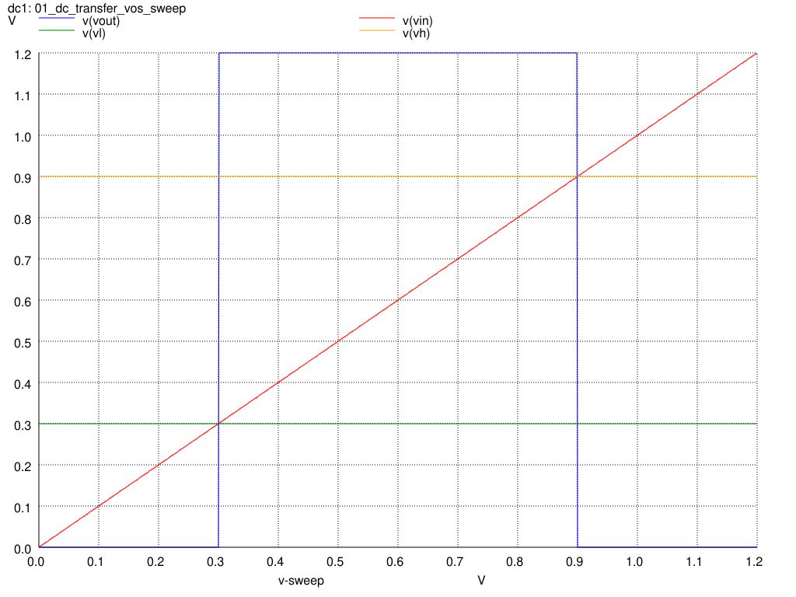

# 01_dc_transfer_vos_sweep

**DC Transfer, Thresholds & Offset (VOS)**

| Field | Value |
| :--- | :--- |
| **Project** | `WINCOMP_Verification_Suite` |
| **Target Block** | `wind_comp` (TOP) |
| **Suite** | Proposal |
| **PDK Corner / Conditions** | `mos_tt` |
| **Hardcopy Target** | `../plots/@name\\.svg` |
| **Data Export** | `write` |
| **Overall Status** | `PASS` |

## 1. Measured Results Metrics

| Parameter | Target Spec | Measured Value | Unit | Status |
| :--- | :--- | :--- | :-: | :-: |
| `vth_l` | 0.300 ± 0.020 | **3.005000e-01** | V | PASS |
| `vth_h` | 0.900 ± 0.020 | **8.995000e-01** | V | PASS |
| `win_w` | 0.600 nominal | **5.990000e-01** | V | PASS |

## 2. Engineering Notes

******
** ngspice-47 : Circuit level simulation program
** Compiled with KLU Direct Linear Solver
** The U. C. Berkeley CAD Group
** Copyright 1985-1994, Regents of the University of California.
** Copyright 2001-2026, The ngspice team.
** Please get your ngspice manual from https://ngspice.sourceforge.io/docs.html
** Please file your bug-reports at http://ngspice.sourceforge.net/bugrep.html
** Creation Date: Thu Oct 15 12:58:05 UTC 2026
******
||: No such file or directory

Note: No compatibility mode selected!


Circuit: ** sch_path: /foss/designs/skills/sg13cmos5l_wind_comp/schematic/xschem/wind_comp/wind_comp_tb.sch

Doing analysis at TEMP = 27.000000 and TNOM = 27.000000

Using SPARSE 1.3 as Direct Linear Solver
Note: Starting dynamic gmin stepping
Note: Dynamic gmin stepping completed
 Reference value :  0.00000e+00
No. of Data Rows : 1
ASCII raw file "wind_comp_tb.raw"
Doing analysis at TEMP = 27.000000 and TNOM = 27.000000

Using SPARSE 1.3 as Direct Linear Solver
Note: Starting dynamic gmin stepping
Note: Dynamic gmin stepping completed
 Reference value :  1.19700e+00
No. of Data Rows : 1201
vth_l               =  3.00500e-01
vth_h               =  8.99500e-01
vth_l = 3.005000e-01
vth_h = 8.995000e-01
win_w = 5.990000e-01
ASCII raw file "1.raw"
Warning: Missing charsets in String to FontSet conversion

The file "../plots/1.svg" has the Scalable Vector Graphics format.
ngspice 2 ->

## 3. Principal Code (`principal.spice`)

```spice
.param vdd=1.2 vss=0 vcm=0.6 vrise=0.3
.param vh={vcm+vrise} vl={vcm-vrise}
.param ibias=1u en=1.2 cload=0.1p rload=1G
.param fin=10k vamp=0.6 tnom=27
.param ac_vdd=0 ac_vss=0
.temp {tnom}
.option method=gear
.option savecurrents
.option filetype=ascii
.option color0=white
.option color1=black
.option hcopydevtype=svg
Vdd vdd 0 dc {vdd} ac {ac_vdd}
Vvh vh 0 dc {vh}
Cload vout 0 {cload}
Rload vout vss {rload}
Vvl vl 0 dc {vl}
Ibias vdd ibias dc {ibias}
Vss vss 0 dc {vss} ac {ac_vss}
Ven en 0 dc {en}
```

## 4. Active Code (`active.spice`)

```spice
Vin vin 0 dc {vcm}
.control
save all
dc Vin 0 1.2 1m
meas dc vth_l WHEN v(vout)=0.6 RISE=1
meas dc vth_h WHEN v(vout)=0.6 FALL=1
let win_w = vth_h - vth_l
print vth_l vth_h win_w
write @name\\.raw v(vin) v(vout)
plot v(vin) v(vout) v(vh) v(vl) title "01_dc_transfer_vos_sweep"
set hcopydevtype=svg
hardcopy ../plots/@name\\.svg v(vin) v(vout) v(vh) v(vl) title "01_dc_transfer_vos_sweep"
.endc
```

## 5. Xschem `code_shown.sym` Snippets (`xschem_code_shown.txt`)

```text
C {devices/code_shown.sym} -220 -160 0 0 {name=PRINCIPAL_BLOCK
only_toplevel=true
format="tcleval( @value )"
value="
.param vdd=1.2 vss=0 vcm=0.6 vrise=0.3
.param vh={vcm+vrise} vl={vcm-vrise}
.param ibias=1u en=1.2 cload=0.1p rload=1G
.param fin=10k vamp=0.6 tnom=27
.param ac_vdd=0 ac_vss=0
.temp {tnom}
.option method=gear
.option savecurrents
.option filetype=ascii
.option color0=white
.option color1=black
.option hcopydevtype=svg
Vdd vdd 0 dc {vdd} ac {ac_vdd}
Vvh vh 0 dc {vh}
Cload vout 0 {cload}
Rload vout vss {rload}
Vvl vl 0 dc {vl}
Ibias vdd ibias dc {ibias}
Vss vss 0 dc {vss} ac {ac_vss}
Ven en 0 dc {en}
"
place=header}
C {devices/code_shown.sym} -220 80 0 0 {name=01_dc_transfer_vos_sweep
only_toplevel=true
format="tcleval( @value )"
value="
Vin vin 0 dc {vcm}
.control
save all
dc Vin 0 1.2 1m
meas dc vth_l WHEN v(vout)=0.6 RISE=1
meas dc vth_h WHEN v(vout)=0.6 FALL=1
let win_w = vth_h - vth_l
print vth_l vth_h win_w
write @name\\.raw v(vin) v(vout)
plot v(vin) v(vout) v(vh) v(vl) title \"01_dc_transfer_vos_sweep\"
set hcopydevtype=svg
hardcopy ../plots/@name\\.svg v(vin) v(vout) v(vh) v(vl) title \"01_dc_transfer_vos_sweep\"
.endc
"
place=end}
```

## 6. Result Figures

### Figure 1: 01_dc_transfer_vos_sweep — 01_dc_transfer_vos_sweep.svg


