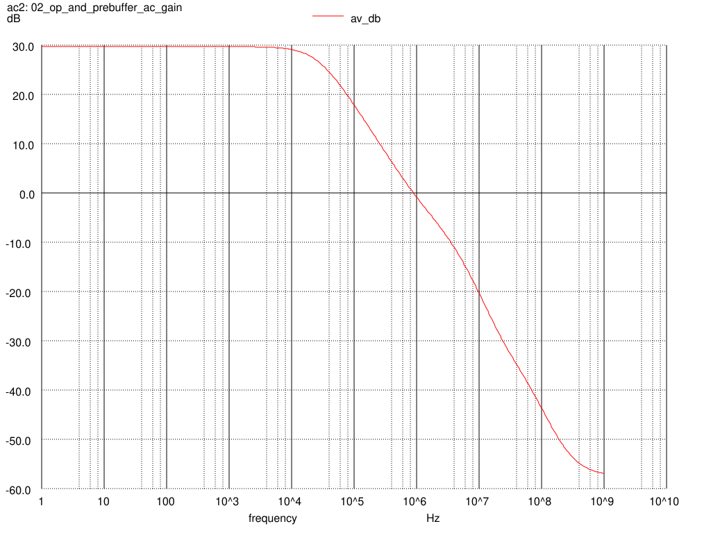

# 02_op_and_prebuffer_ac_gain

**DC Operating Point (.op) & Pre-Buffer AC Gain (AVDC)**

| Field | Value |
| :--- | :--- |
| **Project** | `WINCOMP_Verification_Suite` |
| **Target Block** | `wind_comp` (TOP) |
| **Suite** | Proposal |
| **PDK Corner / Conditions** | `mos_tt` |
| **Hardcopy Target** | `../plots/@name\\.svg` |
| **Data Export** | `write` |
| **Overall Status** | `PENDING` |

## 1. Measured Results Metrics

| Parameter | Target Spec | Measured Value | Unit | Status |
| :--- | :--- | :--- | :-: | :-: |
| `f3db` | Report -3 dB BW | **2.63892e+04** | MHz | PENDING |
| `new_metric` | TBD | **—** | — | PENDING |

## 3. Principal Code (`principal.spice`)

```spice
.param vdd=1.2 vss=0 vcm=0.6 vrise=0.3
.param vh={vcm+vrise} vl={vcm-vrise}
.param ibias=1u en=1.2 cload=0.1p rload=1G
.param fin=10k vamp=0.6 tnom=27
.param ac_vdd=0 ac_vss=0
.temp {tnom}
.option method=gear
.option savecurrents
.option filetype=ascii
.option color0=white
.option color1=black
.option hcopydevtype=svg
Vdd vdd 0 dc {vdd} ac {ac_vdd}
Vvh vh 0 dc {vh}
Cload vout 0 {cload}
Rload vout vss {rload}
Vvl vl 0 dc {vl}
Ibias vdd ibias dc {ibias}
Vss vss 0 dc {vss} ac {ac_vss}
Ven en 0 dc {en}
```

## 4. Active Code (`active.spice`)

```spice
Vin vin 0 dc {vl} ac 1
.control
save all
op
ac dec 50 1 1G
let av_db = db(v(xcomp1.x2.vop))
meas ac avdc_db FIND av_db AT=10
let av_3db = avdc_db - 3
meas ac f3db WHEN av_db=$&av_3db FALL=1
print avdc_db f3db
write @name\\.raw av_db
plot av_db title "02_op_and_prebuffer_ac_gain"
set hcopydevtype=svg
hardcopy ../plots/@name\\.svg av_db title "02_op_and_prebuffer_ac_gain"
.endc
```

## 5. Xschem `code_shown.sym` Snippets (`xschem_code_shown.txt`)

```text
C {devices/code_shown.sym} -220 -160 0 0 {name=PRINCIPAL_BLOCK
only_toplevel=true
format="tcleval( @value )"
value="
.param vdd=1.2 vss=0 vcm=0.6 vrise=0.3
.param vh={vcm+vrise} vl={vcm-vrise}
.param ibias=1u en=1.2 cload=0.1p rload=1G
.param fin=10k vamp=0.6 tnom=27
.param ac_vdd=0 ac_vss=0
.temp {tnom}
.option method=gear
.option savecurrents
.option filetype=ascii
.option color0=white
.option color1=black
.option hcopydevtype=svg
Vdd vdd 0 dc {vdd} ac {ac_vdd}
Vvh vh 0 dc {vh}
Cload vout 0 {cload}
Rload vout vss {rload}
Vvl vl 0 dc {vl}
Ibias vdd ibias dc {ibias}
Vss vss 0 dc {vss} ac {ac_vss}
Ven en 0 dc {en}
"
place=header}
C {devices/code_shown.sym} -220 80 0 0 {name=02_op_and_prebuffer_ac_gain
only_toplevel=true
format="tcleval( @value )"
value="
Vin vin 0 dc {vl} ac 1
.control
save all
op
ac dec 50 1 1G
let av_db = db(v(xcomp1.x2.vop))
meas ac avdc_db FIND av_db AT=10
let av_3db = avdc_db - 3
meas ac f3db WHEN av_db=$&av_3db FALL=1
print avdc_db f3db
write @name\\.raw av_db
plot av_db title \"02_op_and_prebuffer_ac_gain\"
set hcopydevtype=svg
hardcopy ../plots/@name\\.svg av_db title \"02_op_and_prebuffer_ac_gain\"
.endc
"
place=end}
```

## 6. Result Figures

*No result figures attached yet.*


## 6. Result Figures

### Figure 1: 02_op_and_prebuffer_ac_gain — 2.svg


