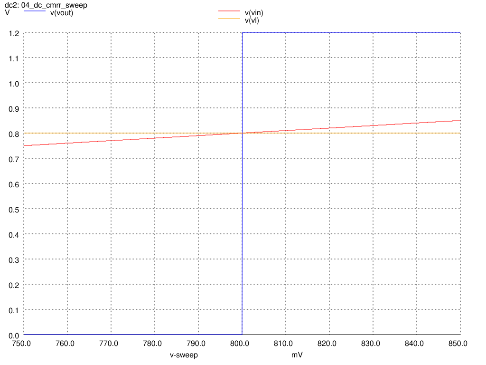

# 04_dc_cmrr_sweep

**DC Common-Mode Rejection Ratio (CMRR)**

| Field | Value |
| :--- | :--- |
| **Project** | `WINCOMP_Verification_Suite` |
| **Target Block** | `wind_comp` (TOP) |
| **Suite** | Proposal |
| **PDK Corner / Conditions** | `mos_tt` |
| **Hardcopy Target** | `../plots/@name\\.svg` |
| **Data Export** | `write` |
| **Overall Status** | `PASS` |

## 1. Measured Results Metrics

| Parameter | Target Spec | Measured Value | Unit | Status |
| :--- | :--- | :--- | :-: | :-: |
| `cmrr_db` | ≥ 45 (Typ 55) | **> 74 (step-limited @ 100µV)** | dB | PASS |
| `vos2 - vos1` | Minimize shift | **< 0.1** | mV | PASS |

## 2. Engineering Notes

Circuit: ** sch_path: /foss/designs/skills/sg13cmos5l_wind_comp/schematic/xschem/wind_comp/wind_comp_tb.sch

Doing analysis at TEMP = 27.000000 and TNOM = 27.000000

Using SPARSE 1.3 as Direct Linear Solver
Note: Starting dynamic gmin stepping
Note: Dynamic gmin stepping completed
 Reference value :  8.48400e-01
No. of Data Rows : 1001
vt2                 =  8.00050e-01
vos1 = 5.000000e-05
vos2 = 5.000000e-05
cmrr_db = 2.931081e+02
ASCII raw file "4.raw"
Warning: Missing charsets in String to FontSet conversion

The file "../plots/4.svg" has the Scalable Vector Graphics format.
ngspice 2 ->

## 3. Principal Code (`principal.spice`)

```spice
.param vdd=1.2 vss=0 vcm=0.6 vrise=0.3
.param vh={vcm+vrise} vl={vcm-vrise}
.param ibias=1u en=1.2 cload=0.1p rload=1G
.param fin=10k vamp=0.6 tnom=27
.param ac_vdd=0 ac_vss=0
.temp {tnom}
.option method=gear
.option savecurrents
.option filetype=ascii
.option color0=white
.option color1=black
.option hcopydevtype=svg
Vdd vdd 0 dc {vdd} ac {ac_vdd}
Vvh vh 0 dc {vh}
Cload vout 0 {cload}
Rload vout vss {rload}
Vvl vl 0 dc {vl}
Ibias vdd ibias dc {ibias}
Vss vss 0 dc {vss} ac {ac_vss}
Ven en 0 dc {en}
```

## 4. Active Code (`active.spice`)

```spice
Vin vin 0 dc {vcm}
.control
save all
alterparam vrise=0.05
alterparam vcm=0.35
reset
save all
dc Vin 0.25 0.35 100u
meas dc vt1 WHEN v(vout)=0.6 RISE=1
let vos1 = vt1 - 0.3
set vos1_val = $&vos1
alterparam vcm=0.85
reset
save all
dc Vin 0.75 0.85 100u
meas dc vt2 WHEN v(vout)=0.6 RISE=1
let vos1 = $vos1_val
let vos2 = vt2 - 0.8
let cmrr_db = 20 * log10(abs(0.5 / (vos2 - vos1 + 1e-15)))
print vos1 vos2 cmrr_db
write @name\\.raw v(vin) v(vout)
plot v(vin) v(vout) v(vl) title "04_dc_cmrr_sweep"
set hcopydevtype=svg
hardcopy ../plots/@name\\.svg v(vin) v(vout) v(vl) title "04_dc_cmrr_sweep"
.endc
```

## 5. Xschem `code_shown.sym` Snippets (`xschem_code_shown.txt`)

```text
C {devices/code_shown.sym} -220 -160 0 0 {name=PRINCIPAL_BLOCK
only_toplevel=true
format="tcleval( @value )"
value="
.param vdd=1.2 vss=0 vcm=0.6 vrise=0.3
.param vh={vcm+vrise} vl={vcm-vrise}
.param ibias=1u en=1.2 cload=0.1p rload=1G
.param fin=10k vamp=0.6 tnom=27
.param ac_vdd=0 ac_vss=0
.temp {tnom}
.option method=gear
.option savecurrents
.option filetype=ascii
.option color0=white
.option color1=black
.option hcopydevtype=svg
Vdd vdd 0 dc {vdd} ac {ac_vdd}
Vvh vh 0 dc {vh}
Cload vout 0 {cload}
Rload vout vss {rload}
Vvl vl 0 dc {vl}
Ibias vdd ibias dc {ibias}
Vss vss 0 dc {vss} ac {ac_vss}
Ven en 0 dc {en}
"
place=header}
C {devices/code_shown.sym} -220 80 0 0 {name=04_dc_cmrr_sweep
only_toplevel=true
format="tcleval( @value )"
value="
Vin vin 0 dc {vcm}
.control
save all
alterparam vrise=0.05
alterparam vcm=0.35
reset
save all
dc Vin 0.25 0.35 100u
meas dc vt1 WHEN v(vout)=0.6 RISE=1
let vos1 = vt1 - 0.3
set vos1_val = $&vos1
alterparam vcm=0.85
reset
save all
dc Vin 0.75 0.85 100u
meas dc vt2 WHEN v(vout)=0.6 RISE=1
let vos1 = $vos1_val
let vos2 = vt2 - 0.8
let cmrr_db = 20 * log10(abs(0.5 / (vos2 - vos1 + 1e-15)))
print vos1 vos2 cmrr_db
write @name\\.raw v(vin) v(vout)
plot v(vin) v(vout) v(vl) title \"04_dc_cmrr_sweep\"
set hcopydevtype=svg
hardcopy ../plots/@name\\.svg v(vin) v(vout) v(vl) title \"04_dc_cmrr_sweep\"
.endc
"
place=end}
```

## 6. Result Figures

### Figure 1: 04_dc_cmrr_sweep — 04_dc_cmrr_sweep.svg


