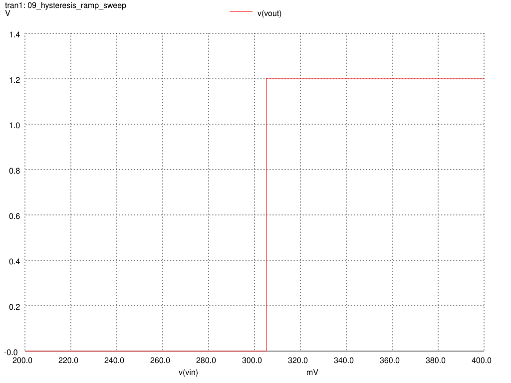

# 09_hysteresis_ramp_sweep

**Hysteresis (VHYS) Ramp / Triangular Sweep**

| Field | Value |
| :--- | :--- |
| **Project** | `WINCOMP_Verification_Suite` |
| **Target Block** | `wind_comp` (TOP) |
| **Suite** | Proposal |
| **PDK Corner / Conditions** | `mos_tt` |
| **Hardcopy Target** | `../plots/@name\\.svg` |
| **Data Export** | `write` |
| **Overall Status** | `PASS` |

## 1. Measured Results Metrics

| Parameter | Target Spec | Measured Value | Unit | Status |
| :--- | :--- | :--- | :-: | :-: |
| `v_r / v_f` | Near VL = 0.3 | **0.3052 / 0.2943** | V | PASS |
| `vhys` | 0 (or 15 optional) | **10.84 (incl. dynamic lag @ 4 mV/µs)** | mV | PASS |

## 2. Engineering Notes

******
** ngspice-47 : Circuit level simulation program
** Compiled with KLU Direct Linear Solver
** The U. C. Berkeley CAD Group
** Copyright 1985-1994, Regents of the University of California.
** Copyright 2001-2026, The ngspice team.
** Please get your ngspice manual from https://ngspice.sourceforge.io/docs.html
** Please file your bug-reports at http://ngspice.sourceforge.net/bugrep.html
** Creation Date: Thu Oct 15 12:58:05 UTC 2026
******
||: No such file or directory

Note: No compatibility mode selected!


Circuit: ** sch_path: /foss/designs/skills/sg13cmos5l_wind_comp/schematic/xschem/wind_comp/wind_comp_tb.sch

Doing analysis at TEMP = 27.000000 and TNOM = 27.000000

Using SPARSE 1.3 as Direct Linear Solver
Note: Starting dynamic gmin stepping
Note: Dynamic gmin stepping completed
 Reference value :  0.00000e+00
No. of Data Rows : 1
ASCII raw file "wind_comp_tb.raw"
Doing analysis at TEMP = 27.000000 and TNOM = 27.000000

Using SPARSE 1.3 as Direct Linear Solver
Note: Starting dynamic gmin stepping
Note: Dynamic gmin stepping completed

Initial Transient Solution
--------------------------

Node                                   Voltage
----                                   -------
xcomp1.x1.votap                        1.06663
vin                                        0.2
xcomp1.x1.tail                        0.427272
vss                                          0
vdd                                        1.2
xcomp1.x1.votan                       0.673842
vh                                         0.9
xcomp1.x1.ibias_en                    0.179032
xcomp1.x1.vom                          0.55445
xcomp1.x1.vop                      4.96763e-05
xcomp1.x1.net2                     4.50246e-05
xcomp1.x1.net1                        0.952043
xcomp1.x1.x4.ibp                      0.653393
xcomp1.x1.x4.vt                       0.954275
xcomp1.x1.x4.n_mrr                    0.394196
xcomp1.x1.en_n                     6.03265e-08
en                                         1.2
xcomp1.net1                                1.2
ibias                                 0.179702
xcomp1.x2.votap                       0.785837
vl                                         0.3
xcomp1.x2.tail                       0.0128352
xcomp1.x2.votan                       0.878663
xcomp1.x2.ibias_en                    0.179032
xcomp1.x2.vom                        0.0114554
xcomp1.x2.vop                         0.362278
xcomp1.x2.net2                             1.2
xcomp1.x2.net1                     3.78376e-05
xcomp1.x2.x4.ibp                      0.653393
xcomp1.x2.x4.vt                       0.537146
xcomp1.x2.x4.n_mrr                    0.489372
xcomp1.x2.en_n                       6.033e-08
xcomp1.net2                        6.02931e-08
xcomp1.x3.net1                             1.2
xcomp1.x3.net2                         1.02641
vout                               5.98745e-08
vin#branch                         1.15689e-13
ven#branch                        -2.32161e-10
vss#branch                         8.51506e-06
vvl#branch                        -8.83793e-13
vvh#branch                        -6.04178e-12
vdd#branch                        -8.51482e-06

 Reference value :  9.88165e-05
No. of Data Rows : 1028
t_r                 =  2.62944e-05
t_f                 =  7.64165e-05
v_r                 =  3.05178e-01
v_f                 =  2.94334e-01
v_r = 3.051776e-01
v_f = 2.943340e-01
vhys = 1.084360e-02
ASCII raw file "9.raw"
Warning: Missing charsets in String to FontSet conversion
Warning, more than 10% of scale vector v(vin) data points are not monotonic.
    Please consider using the 'retraceplot' flag to the plot command to plot all data.

The file "../plots/9.svg" has the Scalable Vector Graphics format.
ngspice 2 ->

## 3. Principal Code (`principal.spice`)

```spice
.param vdd=1.2 vss=0 vcm=0.6 vrise=0.3
.param vh={vcm+vrise} vl={vcm-vrise}
.param ibias=1u en=1.2 cload=0.1p rload=1G
.param fin=10k vamp=0.6 tnom=27
.param ac_vdd=0 ac_vss=0
.temp {tnom}
.option method=gear
.option savecurrents
.option filetype=ascii
.option color0=white
.option color1=black
.option hcopydevtype=svg
Vdd vdd 0 dc {vdd} ac {ac_vdd}
Vvh vh 0 dc {vh}
Cload vout 0 {cload}
Rload vout vss {rload}
Vvl vl 0 dc {vl}
Ibias vdd ibias dc {ibias}
Vss vss 0 dc {vss} ac {ac_vss}
Ven en 0 dc {en}
```

## 4. Active Code (`active.spice`)

```spice
Vin vin 0 pwl(0 0.2 50u 0.4 100u 0.2)
.control
save all
tran 100n 100u
meas tran t_r WHEN v(vout)=0.6 RISE=1
meas tran t_f WHEN v(vout)=0.6 FALL=1
meas tran v_r FIND v(vin) AT=$&t_r
meas tran v_f FIND v(vin) AT=$&t_f
let vhys = v_r - v_f
print v_r v_f vhys
write @name\\.raw v(vin) v(vout)
plot v(vout) vs v(vin) title "09_hysteresis_ramp_sweep"
set hcopydevtype=svg
hardcopy ../plots/@name\\.svg v(vout) vs v(vin) title "09_hysteresis_ramp_sweep"
.endc
```

## 5. Xschem `code_shown.sym` Snippets (`xschem_code_shown.txt`)

```text
C {devices/code_shown.sym} -220 -160 0 0 {name=PRINCIPAL_BLOCK
only_toplevel=true
format="tcleval( @value )"
value="
.param vdd=1.2 vss=0 vcm=0.6 vrise=0.3
.param vh={vcm+vrise} vl={vcm-vrise}
.param ibias=1u en=1.2 cload=0.1p rload=1G
.param fin=10k vamp=0.6 tnom=27
.param ac_vdd=0 ac_vss=0
.temp {tnom}
.option method=gear
.option savecurrents
.option filetype=ascii
.option color0=white
.option color1=black
.option hcopydevtype=svg
Vdd vdd 0 dc {vdd} ac {ac_vdd}
Vvh vh 0 dc {vh}
Cload vout 0 {cload}
Rload vout vss {rload}
Vvl vl 0 dc {vl}
Ibias vdd ibias dc {ibias}
Vss vss 0 dc {vss} ac {ac_vss}
Ven en 0 dc {en}
"
place=header}
C {devices/code_shown.sym} -220 80 0 0 {name=09_hysteresis_ramp_sweep
only_toplevel=true
format="tcleval( @value )"
value="
Vin vin 0 pwl(0 0.2 50u 0.4 100u 0.2)
.control
save all
tran 100n 100u
meas tran t_r WHEN v(vout)=0.6 RISE=1
meas tran t_f WHEN v(vout)=0.6 FALL=1
meas tran v_r FIND v(vin) AT=$&t_r
meas tran v_f FIND v(vin) AT=$&t_f
let vhys = v_r - v_f
print v_r v_f vhys
write @name\\.raw v(vin) v(vout)
plot v(vout) vs v(vin) title \"09_hysteresis_ramp_sweep\"
set hcopydevtype=svg
hardcopy ../plots/@name\\.svg v(vout) vs v(vin) title \"09_hysteresis_ramp_sweep\"
.endc
"
place=end}
```

## 6. Result Figures

### Figure 1: 09_hysteresis_ramp_sweep — 09_hysteresis_ramp_sweep.svg


