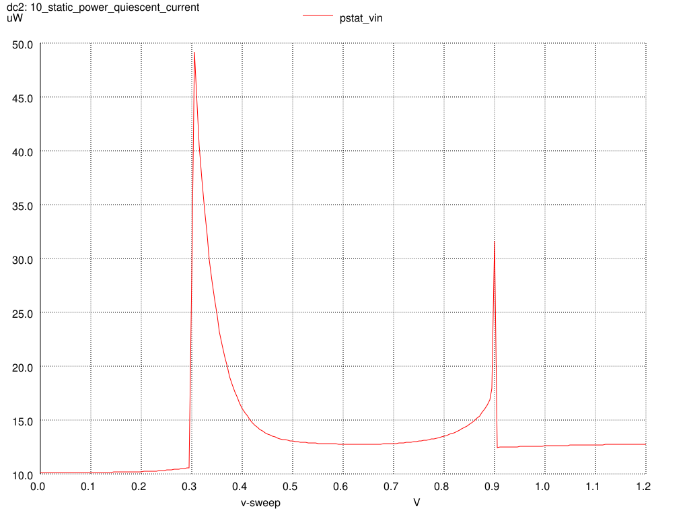

# 10_static_power_quiescent_current

**Static Power (PSTAT) & Quiescent Current (IQ)**

| Field | Value |
| :--- | :--- |
| **Project** | `WINCOMP_Verification_Suite` |
| **Target Block** | `wind_comp` (TOP) |
| **Suite** | Proposal |
| **PDK Corner / Conditions** | `mos_tt` |
| **Hardcopy Target** | `../plots/@name\\.svg` |
| **Data Export** | `write` |
| **Overall Status** | `PASS` |

## 1. Measured Results Metrics

| Parameter | Target Spec | Measured Value | Unit | Status |
| :--- | :--- | :--- | :-: | :-: |
| `iq_tot` | Typ ~12.5 | **10.64** | µA | PASS |
| `pstat` | ≤ 30 (Typ 15) | **12.77** | µW | PASS |

## 2. Engineering Notes

******
** ngspice-47 : Circuit level simulation program
** Compiled with KLU Direct Linear Solver
** The U. C. Berkeley CAD Group
** Copyright 1985-1994, Regents of the University of California.
** Copyright 2001-2026, The ngspice team.
** Please get your ngspice manual from https://ngspice.sourceforge.io/docs.html
** Please file your bug-reports at http://ngspice.sourceforge.net/bugrep.html
** Creation Date: Thu Oct 15 12:58:05 UTC 2026
******
||: No such file or directory

Note: No compatibility mode selected!


Circuit: ** sch_path: /foss/designs/skills/sg13cmos5l_wind_comp/schematic/xschem/wind_comp/wind_comp_tb.sch

Doing analysis at TEMP = 27.000000 and TNOM = 27.000000

Using SPARSE 1.3 as Direct Linear Solver
Warning: singular matrix:  check node x1.slot4_wrapper_0.dig_in[5]

Note: Starting dynamic gmin stepping
Warning: singular matrix:  check node x1.slot4_wrapper_0.ibias1

Warning: Dynamic gmin stepping failed
Note: Starting true gmin stepping
Warning: singular matrix:  check node x1.slot4_wrapper_0.ibias1

Warning: singular matrix:  check node x1.slot4_wrapper_0.ibias1

Warning: singular matrix:  check node x1.slot4_wrapper_0.ibias1

Warning: singular matrix:  check node x1.slot4_wrapper_0.ibias1

Warning: True gmin stepping failed
Note: Starting source stepping
Warning: source stepping failed
Note: Transient op started
Note: Transient op finished successfully
 Reference value :  0.00000e+00
No. of Data Rows : 1
ASCII raw file "wind_comp_tb.raw"
Doing analysis at TEMP = 27.000000 and TNOM = 27.000000

Using SPARSE 1.3 as Direct Linear Solver
Note: Starting dynamic gmin stepping
Warning: singular matrix:  check node x1.slot4_wrapper_0.dig_out[5]

Warning: Dynamic gmin stepping failed
Note: Starting true gmin stepping
Warning: singular matrix:  check node x1.slot4_wrapper_0.dig_out[5]

Warning: singular matrix:  check node x1.slot4_wrapper_0.dig_out[5]

Warning: singular matrix:  check node x1.slot4_wrapper_0.dig_out[5]

Warning: singular matrix:  check node x1.slot4_wrapper_0.dig_out[5]

Warning: singular matrix:  check node x1.slot4_wrapper_0.dig_out[5]

Warning: True gmin stepping failed
Note: Starting source stepping
Warning: source stepping failed
Note: Transient op started
Note: Transient op finished successfully
 Reference value :  0.00000e+00
No. of Data Rows : 1
Doing analysis at TEMP = 27.000000 and TNOM = 27.000000

Using SPARSE 1.3 as Direct Linear Solver
Note: Starting dynamic gmin stepping
Warning: singular matrix:  check node x1.slot4_wrapper_0.dig_out[5]

Warning: Dynamic gmin stepping failed
Note: Starting true gmin stepping
Warning: singular matrix:  check node x1.slot4_wrapper_0.dig_out[5]

Warning: singular matrix:  check node x1.slot4_wrapper_0.dig_out[5]

Warning: singular matrix:  check node x1.slot4_wrapper_0.dig_out[5]

Warning: singular matrix:  check node x1.slot4_wrapper_0.dig_out[5]

Warning: singular matrix:  check node x1.slot4_wrapper_0.dig_out[5]

Warning: True gmin stepping failed
Note: Starting source stepping
Warning: source stepping failed
Note: Transient op started
Note: Transient op finished successfully
Note: Starting dynamic gmin stepping
Warning: Dynamic gmin stepping failed
Note: Starting true gmin stepping
Warning: True gmin stepping failed
Note: Starting source stepping
Warning: source stepping failed
Note: Transient op started
Note: Transient op finished successfully
 Reference value :  1.17000e+00
No. of Data Rows : 241
op2.iq_tot = 1.064148e-05
op2.pstat = 1.276978e-05
ASCII raw file "10.raw"
Warning: Missing charsets in String to FontSet conversion

The file "../plots/10.svg" has the Scalable Vector Graphics format.
ngspice 2 -> 
The file "/headless/tmp/hc424_0.ps" may be printed on a postscript printer.

## 3. Principal Code (`principal.spice`)

```spice
.param vdd=1.2 vss=0 vcm=0.6 vrise=0.3
.param vh={vcm+vrise} vl={vcm-vrise}
.param ibias=1u en=1.2 cload=0.1p rload=1G
.param fin=10k vamp=0.6 tnom=27
.param ac_vdd=0 ac_vss=0
.temp {tnom}
.option method=gear
.option savecurrents
.option filetype=ascii
.option color0=white
.option color1=black
.option hcopydevtype=svg
Vdd vdd 0 dc {vdd} ac {ac_vdd}
Vvh vh 0 dc {vh}
Cload vout 0 {cload}
Rload vout vss {rload}
Vvl vl 0 dc {vl}
Ibias vdd ibias dc {ibias}
Vss vss 0 dc {vss} ac {ac_vss}
Ven en 0 dc {en}
```

## 4. Active Code (`active.spice`)

```spice
Vin vin 0 dc {vcm}
.control
save all
op
let iq_tot = -i(Vdd)
let pstat = iq_tot * v(vdd)
set p_op = $curplot
dc Vin 0 1.2 5m
let pstat_vin = -i(Vdd) * v(vdd)
print {$p_op}.iq_tot {$p_op}.pstat
write @name\\.raw v(vin) pstat_vin
plot pstat_vin title "10_static_power_quiescent_current"
set hcopydevtype=svg
hardcopy ../plots/@name\\.svg pstat_vin title "10_static_power_quiescent_current"
.endc
```

## 5. Xschem `code_shown.sym` Snippets (`xschem_code_shown.txt`)

```text
C {devices/code_shown.sym} -220 -160 0 0 {name=PRINCIPAL_BLOCK
only_toplevel=true
format="tcleval( @value )"
value="
.param vdd=1.2 vss=0 vcm=0.6 vrise=0.3
.param vh={vcm+vrise} vl={vcm-vrise}
.param ibias=1u en=1.2 cload=0.1p rload=1G
.param fin=10k vamp=0.6 tnom=27
.param ac_vdd=0 ac_vss=0
.temp {tnom}
.option method=gear
.option savecurrents
.option filetype=ascii
.option color0=white
.option color1=black
.option hcopydevtype=svg
Vdd vdd 0 dc {vdd} ac {ac_vdd}
Vvh vh 0 dc {vh}
Cload vout 0 {cload}
Rload vout vss {rload}
Vvl vl 0 dc {vl}
Ibias vdd ibias dc {ibias}
Vss vss 0 dc {vss} ac {ac_vss}
Ven en 0 dc {en}
"
place=header}
C {devices/code_shown.sym} -220 80 0 0 {name=10_static_power_quiescent_current
only_toplevel=true
format="tcleval( @value )"
value="
Vin vin 0 dc {vcm}
.control
save all
op
let iq_tot = -i(Vdd)
let pstat = iq_tot * v(vdd)
set p_op = $curplot
dc Vin 0 1.2 5m
let pstat_vin = -i(Vdd) * v(vdd)
print {$p_op}.iq_tot {$p_op}.pstat
write @name\\.raw v(vin) pstat_vin
plot pstat_vin title \"10_static_power_quiescent_current\"
set hcopydevtype=svg
hardcopy ../plots/@name\\.svg pstat_vin title \"10_static_power_quiescent_current\"
.endc
"
place=end}
```

## 6. Result Figures

### Figure 1: 10_static_power_quiescent_current — 10.svg


