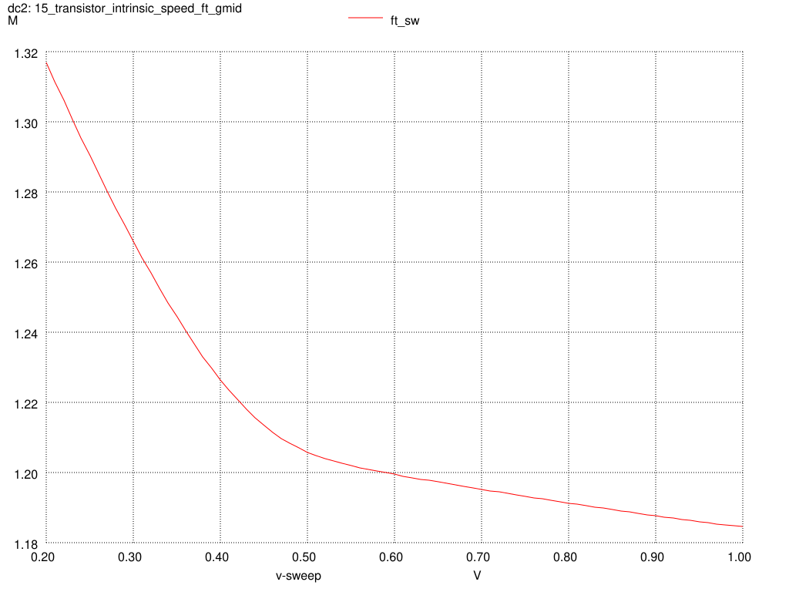

# 15_transistor_intrinsic_speed_ft_gmid

**Transistor Intrinsic Speed & Sizing (fT, gm/ID, Vdsat)**

| Field | Value |
| :--- | :--- |
| **Project** | `WINCOMP_Verification_Suite` |
| **Target Block** | `wind_comp` (TOP) |
| **Suite** | General |
| **PDK Corner / Conditions** | `mos_tt` |
| **Hardcopy Target** | `../plots/@name\\.svg` |
| **Data Export** | `write` |
| **Overall Status** | `PENDING` |

## 1. Measured Results Metrics

| Parameter | Target Spec | Measured Value | Unit | Status |
| :--- | :--- | :--- | :-: | :-: |
| `ft_m1` | Report transit freq | **0.00127 (1.266 MHz)** | GHz | PENDING |
| `gmid_m1` | 10 – 20 (mod inv) | **31.43** | S/A | PENDING |
| `av0_m1 (gm/gds)` | Report intrinsic gain | **63.80** | V/V | PENDING |

## 2. Engineering Notes

******
** ngspice-47 : Circuit level simulation program
** Compiled with KLU Direct Linear Solver
** The U. C. Berkeley CAD Group
** Copyright 1985-1994, Regents of the University of California.
** Copyright 2001-2026, The ngspice team.
** Please get your ngspice manual from https://ngspice.sourceforge.io/docs.html
** Please file your bug-reports at http://ngspice.sourceforge.net/bugrep.html
** Creation Date: Thu Oct 15 12:58:05 UTC 2026
******
||: No such file or directory

Note: No compatibility mode selected!


Circuit: ** sch_path: /foss/designs/skills/sg13cmos5l_wind_comp/schematic/xschem/wind_comp/wind_comp_tb.sch

Doing analysis at TEMP = 27.000000 and TNOM = 27.000000

Using SPARSE 1.3 as Direct Linear Solver
Note: Starting dynamic gmin stepping
Note: Dynamic gmin stepping completed
 Reference value :  0.00000e+00
No. of Data Rows : 1
ASCII raw file "wind_comp_tb.raw"
Doing analysis at TEMP = 27.000000 and TNOM = 27.000000

Using SPARSE 1.3 as Direct Linear Solver
Note: Starting dynamic gmin stepping
Note: Dynamic gmin stepping completed
 Reference value :  0.00000e+00
No. of Data Rows : 1
Doing analysis at TEMP = 27.000000 and TNOM = 27.000000

Using SPARSE 1.3 as Direct Linear Solver
Note: Starting dynamic gmin stepping
Note: Dynamic gmin stepping completed
 Reference value :  9.10000e-01
No. of Data Rows : 81
op2.gm_m1 = 2.989945e-09
op2.id_m1 = 9.512157e-11
op2.gmid_m1 = 3.143288e+01
op2.ft_m1 = 1.265919e+06
op2.av0_m1 = 6.380161e+01
ASCII raw file "15.raw"
Warning: Missing charsets in String to FontSet conversion

The file "../plots/15.svg" has the Scalable Vector Graphics format.
ngspice 2 ->

## 3. Principal Code (`principal.spice`)

```spice
.param vdd=1.2 vss=0 vcm=0.6 vrise=0.3
.param vh={vcm+vrise} vl={vcm-vrise}
.param ibias=1u en=1.2 cload=0.1p rload=1G
.param fin=10k vamp=0.6 tnom=27
.param ac_vdd=0 ac_vss=0
.temp {tnom}
.option method=gear
.option savecurrents
.option filetype=ascii
.option color0=white
.option color1=black
.option hcopydevtype=svg
Vdd vdd 0 dc {vdd} ac {ac_vdd}
Vvh vh 0 dc {vh}
Cload vout 0 {cload}
Rload vout vss {rload}
Vvl vl 0 dc {vl}
Ibias vdd ibias dc {ibias}
Vss vss 0 dc {vss} ac {ac_vss}
Ven en 0 dc {en}
```

## 4. Active Code (`active.spice`)

```spice
Vin vin 0 dc {vl}
.control
save all @n.xcomp1.x2.xm1.nsg13_lv_nmos[gm] @n.xcomp1.x2.xm1.nsg13_lv_nmos[ids] @n.xcomp1.x2.xm1.nsg13_lv_nmos[cgg] @n.xcomp1.x2.xm1.nsg13_lv_nmos[vds] @n.xcomp1.x2.xm1.nsg13_lv_nmos[vth] @n.xcomp1.x2.xm1.nsg13_lv_nmos[gds]
op
let gm_m1 = @n.xcomp1.x2.xm1.nsg13_lv_nmos[gm]
let id_m1 = @n.xcomp1.x2.xm1.nsg13_lv_nmos[ids]
let cgg_m1 = @n.xcomp1.x2.xm1.nsg13_lv_nmos[cgg]
let gds_m1 = @n.xcomp1.x2.xm1.nsg13_lv_nmos[gds]
let gmid_m1 = gm_m1 / id_m1
let ft_m1 = gm_m1 / (2 * pi * cgg_m1)
let av0_m1 = gm_m1 / gds_m1
set p_op = $curplot
dc Vin 0.2 1.0 10m
let gm_sw = @n.xcomp1.x2.xm1.nsg13_lv_nmos[gm]
let id_sw = @n.xcomp1.x2.xm1.nsg13_lv_nmos[ids]
let cgg_sw = @n.xcomp1.x2.xm1.nsg13_lv_nmos[cgg]
let gmid_sw = gm_sw / id_sw
let ft_sw = gm_sw / (2 * pi * cgg_sw)
print {$p_op}.gm_m1 {$p_op}.id_m1 {$p_op}.gmid_m1 {$p_op}.ft_m1 {$p_op}.av0_m1
write @name\\.raw v(vin) ft_sw gmid_sw
plot ft_sw title "15_transistor_intrinsic_speed_ft_gmid"
set hcopydevtype=svg
hardcopy ../plots/@name\\.svg ft_sw title "15_transistor_intrinsic_speed_ft_gmid"
.endc
```

## 5. Xschem `code_shown.sym` Snippets (`xschem_code_shown.txt`)

```text
C {devices/code_shown.sym} -220 -160 0 0 {name=PRINCIPAL_BLOCK
only_toplevel=true
format="tcleval( @value )"
value="
.param vdd=1.2 vss=0 vcm=0.6 vrise=0.3
.param vh={vcm+vrise} vl={vcm-vrise}
.param ibias=1u en=1.2 cload=0.1p rload=1G
.param fin=10k vamp=0.6 tnom=27
.param ac_vdd=0 ac_vss=0
.temp {tnom}
.option method=gear
.option savecurrents
.option filetype=ascii
.option color0=white
.option color1=black
.option hcopydevtype=svg
Vdd vdd 0 dc {vdd} ac {ac_vdd}
Vvh vh 0 dc {vh}
Cload vout 0 {cload}
Rload vout vss {rload}
Vvl vl 0 dc {vl}
Ibias vdd ibias dc {ibias}
Vss vss 0 dc {vss} ac {ac_vss}
Ven en 0 dc {en}
"
place=header}
C {devices/code_shown.sym} -220 80 0 0 {name=15_transistor_intrinsic_speed_ft_gmid
only_toplevel=true
format="tcleval( @value )"
value="
Vin vin 0 dc {vl}
.control
save all @n.xcomp1.x2.xm1.nsg13_lv_nmos[gm] @n.xcomp1.x2.xm1.nsg13_lv_nmos[ids] @n.xcomp1.x2.xm1.nsg13_lv_nmos[cgg] @n.xcomp1.x2.xm1.nsg13_lv_nmos[vds] @n.xcomp1.x2.xm1.nsg13_lv_nmos[vth] @n.xcomp1.x2.xm1.nsg13_lv_nmos[gds]
op
let gm_m1 = @n.xcomp1.x2.xm1.nsg13_lv_nmos[gm]
let id_m1 = @n.xcomp1.x2.xm1.nsg13_lv_nmos[ids]
let cgg_m1 = @n.xcomp1.x2.xm1.nsg13_lv_nmos[cgg]
let gds_m1 = @n.xcomp1.x2.xm1.nsg13_lv_nmos[gds]
let gmid_m1 = gm_m1 / id_m1
let ft_m1 = gm_m1 / (2 * pi * cgg_m1)
let av0_m1 = gm_m1 / gds_m1
set p_op = $curplot
dc Vin 0.2 1.0 10m
let gm_sw = @n.xcomp1.x2.xm1.nsg13_lv_nmos[gm]
let id_sw = @n.xcomp1.x2.xm1.nsg13_lv_nmos[ids]
let cgg_sw = @n.xcomp1.x2.xm1.nsg13_lv_nmos[cgg]
let gmid_sw = gm_sw / id_sw
let ft_sw = gm_sw / (2 * pi * cgg_sw)
print {$p_op}.gm_m1 {$p_op}.id_m1 {$p_op}.gmid_m1 {$p_op}.ft_m1 {$p_op}.av0_m1
write @name\\.raw v(vin) ft_sw gmid_sw
plot ft_sw title \"15_transistor_intrinsic_speed_ft_gmid\"
set hcopydevtype=svg
hardcopy ../plots/@name\\.svg ft_sw title \"15_transistor_intrinsic_speed_ft_gmid\"
.endc
"
place=end}
```

## 6. Result Figures

### Figure 1: 15_transistor_intrinsic_speed_ft_gmid — 15.svg


