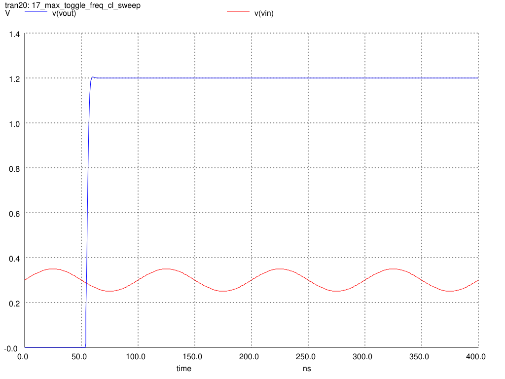

# 17_max_toggle_freq_cl_sweep

**Maximum Toggle Frequency (fmax) & Load (CL) Sweep**

| Field | Value |
| :--- | :--- |
| **Project** | `WINCOMP_Verification_Suite` |
| **Target Block** | `wind_comp` (TOP) |
| **Suite** | General |
| **PDK Corner / Conditions** | `mos_tt` |
| **Hardcopy Target** | `../plots/@name\\.svg` |
| **Data Export** | `write` |
| **Overall Status** | `PASS` |

## 1. Measured Results Metrics

| Parameter | Target Spec | Measured Value | Unit | Status |
| :--- | :--- | :--- | :-: | :-: |
| `fmax @ CL=100f` | Swing ≥ 90% VDD | **1.0 (fails by 5 MHz)** | MHz | PASS |
| `fmax @ CL=1p` | Report max toggle | **1.0 (fails by 5 MHz)** | MHz | PASS |

## 2. Engineering Notes

xcomp1.x1.x4.ibp                      0.653393
xcomp1.x1.x4.vt                       0.954275
xcomp1.x1.x4.n_mrr                    0.394196
xcomp1.x1.en_n                     6.03265e-08
en                                         1.2
xcomp1.net1                                1.2
ibias                                 0.179702
xcomp1.x2.votap                       0.795145
vl                                         0.3
xcomp1.x2.tail                       0.0218161
xcomp1.x2.votan                       0.795145
xcomp1.x2.ibias_en                    0.179032
xcomp1.x2.vom                         0.291719
xcomp1.x2.vop                         0.291719
xcomp1.x2.net2                           1.197
xcomp1.x2.net1                        0.400503
xcomp1.x2.x4.ibp                      0.653393
xcomp1.x2.x4.vt                       0.730312
xcomp1.x2.x4.n_mrr                    0.400099
xcomp1.x2.en_n                     6.03267e-08
xcomp1.net2                        6.41768e-08
xcomp1.x3.net1                             1.2
xcomp1.x3.net2                         1.02641
vout                               5.98745e-08
vin#branch                        -6.53547e-13
ven#branch                        -2.32164e-10
vss#branch                         2.29623e-05
vvl#branch                        -7.64458e-13
vvh#branch                        -6.04178e-12
vdd#branch                         -2.2962e-05

 Reference value :  3.85833e-07
No. of Data Rows : 415
vmax_o              =  1.21328e+00 at=  5.41365e-08
vmin_o              =  5.98727e-08 at=  4.12800e-08
Reset re-loads circuit ** sch_path: /foss/designs/skills/sg13cmos5l_wind_comp/schematic/xschem/wind_comp/wind_comp_tb.sch

Circuit: ** sch_path: /foss/designs/skills/sg13cmos5l_wind_comp/schematic/xschem/wind_comp/wind_comp_tb.sch

Doing analysis at TEMP = 27.000000 and TNOM = 27.000000

Using SPARSE 1.3 as Direct Linear Solver
Note: Starting dynamic gmin stepping
Note: Dynamic gmin stepping completed

Initial Transient Solution
--------------------------

Node                                   Voltage
----                                   -------
xcomp1.x1.votap                        1.06658
vin                                        0.3
xcomp1.x1.tail                        0.427272
vss                                          0
vdd                                        1.2
xcomp1.x1.votan                       0.673842
vh                                         0.9
xcomp1.x1.ibias_en                    0.179032
xcomp1.x1.vom                          0.55445
xcomp1.x1.vop                      4.96976e-05
xcomp1.x1.net2                     4.50246e-05
xcomp1.x1.net1                        0.952043
xcomp1.x1.x4.ibp                      0.653393
xcomp1.x1.x4.vt                       0.954275
xcomp1.x1.x4.n_mrr                    0.394196
xcomp1.x1.en_n                     6.03265e-08
en                                         1.2
xcomp1.net1                                1.2
ibias                                 0.179702
xcomp1.x2.votap                       0.795145
vl                                         0.3
xcomp1.x2.tail                       0.0218161
xcomp1.x2.votan                       0.795145
xcomp1.x2.ibias_en                    0.179032
xcomp1.x2.vom                         0.291719
xcomp1.x2.vop                         0.291719
xcomp1.x2.net2                           1.197
xcomp1.x2.net1                        0.400503
xcomp1.x2.x4.ibp                      0.653393
xcomp1.x2.x4.vt                       0.730312
xcomp1.x2.x4.n_mrr                    0.400099
xcomp1.x2.en_n                     6.03267e-08
xcomp1.net2                        6.41768e-08
xcomp1.x3.net1                             1.2
xcomp1.x3.net2                         1.02641
vout                               5.98745e-08
vin#branch                        -6.53547e-13
ven#branch                        -2.32164e-10
vss#branch                         2.29623e-05
vvl#branch                        -7.64458e-13
vvh#branch                        -6.04178e-12
vdd#branch                         -2.2962e-05

 Reference value :  3.92729e-05
No. of Data Rows : 490
vmax_o              =  1.20335e+00 at=  2.31333e-07
vmin_o              =  -1.04495e-03 at=  3.56802e-05
Reset re-loads circuit ** sch_path: /foss/designs/skills/sg13cmos5l_wind_comp/schematic/xschem/wind_comp/wind_comp_tb.sch

Circuit: ** sch_path: /foss/designs/skills/sg13cmos5l_wind_comp/schematic/xschem/wind_comp/wind_comp_tb.sch

Doing analysis at TEMP = 27.000000 and TNOM = 27.000000

Using SPARSE 1.3 as Direct Linear Solver
Note: Starting dynamic gmin stepping
Note: Dynamic gmin stepping completed

Initial Transient Solution
--------------------------

Node                                   Voltage
----                                   -------
xcomp1.x1.votap                        1.06658
vin                                        0.3
xcomp1.x1.tail                        0.427272
vss                                          0
vdd                                        1.2
xcomp1.x1.votan                       0.673842
vh                                         0.9
xcomp1.x1.ibias_en                    0.179032
xcomp1.x1.vom                          0.55445
xcomp1.x1.vop                      4.96976e-05
xcomp1.x1.net2                     4.50246e-05
xcomp1.x1.net1                        0.952043
xcomp1.x1.x4.ibp                      0.653393
xcomp1.x1.x4.vt                       0.954275
xcomp1.x1.x4.n_mrr                    0.394196
xcomp1.x1.en_n                     6.03265e-08
en                                         1.2
xcomp1.net1                                1.2
ibias                                 0.179702
xcomp1.x2.votap                       0.795145
vl                                         0.3
xcomp1.x2.tail                       0.0218161
xcomp1.x2.votan                       0.795145
xcomp1.x2.ibias_en                    0.179032
xcomp1.x2.vom                         0.291719
xcomp1.x2.vop                         0.291719
xcomp1.x2.net2                           1.197
xcomp1.x2.net1                        0.400503
xcomp1.x2.x4.ibp                      0.653393
xcomp1.x2.x4.vt                       0.730312
xcomp1.x2.x4.n_mrr                    0.400099
xcomp1.x2.en_n                     6.03267e-08
xcomp1.net2                        6.41768e-08
xcomp1.x3.net1                             1.2
xcomp1.x3.net2                         1.02641
vout                               5.98745e-08
vin#branch                        -6.53547e-13
ven#branch                        -2.32164e-10
vss#branch                         2.29623e-05
vvl#branch                        -7.64458e-13
vvh#branch                        -6.04178e-12
vdd#branch                         -2.2962e-05

 Reference value :  7.79061e-06
No. of Data Rows : 487
vmax_o              =  1.20642e+00 at=  4.31072e-06
vmin_o              =  -3.99427e-03 at=  5.37616e-06
Reset re-loads circuit ** sch_path: /foss/designs/skills/sg13cmos5l_wind_comp/schematic/xschem/wind_comp/wind_comp_tb.sch

Circuit: ** sch_path: /foss/designs/skills/sg13cmos5l_wind_comp/schematic/xschem/wind_comp/wind_comp_tb.sch

Doing analysis at TEMP = 27.000000 and TNOM = 27.000000

Using SPARSE 1.3 as Direct Linear Solver
Note: Starting dynamic gmin stepping
Note: Dynamic gmin stepping completed

Initial Transient Solution
--------------------------

Node                                   Voltage
----                                   -------
xcomp1.x1.votap                        1.06658
vin                                        0.3
xcomp1.x1.tail                        0.427272
vss                                          0
vdd                                        1.2
xcomp1.x1.votan                       0.673842
vh                                         0.9
xcomp1.x1.ibias_en                    0.179032
xcomp1.x1.vom                          0.55445
xcomp1.x1.vop                      4.96976e-05
xcomp1.x1.net2                     4.50246e-05
xcomp1.x1.net1                        0.952043
xcomp1.x1.x4.ibp                      0.653393
xcomp1.x1.x4.vt                       0.954275
xcomp1.x1.x4.n_mrr                    0.394196
xcomp1.x1.en_n                     6.03265e-08
en                                         1.2
xcomp1.net1                                1.2
ibias                                 0.179702
xcomp1.x2.votap                       0.795145
vl                                         0.3
xcomp1.x2.tail                       0.0218161
xcomp1.x2.votan                       0.795145
xcomp1.x2.ibias_en                    0.179032
xcomp1.x2.vom                         0.291719
xcomp1.x2.vop                         0.291719
xcomp1.x2.net2                           1.197
xcomp1.x2.net1                        0.400503
xcomp1.x2.x4.ibp                      0.653393
xcomp1.x2.x4.vt                       0.730312
xcomp1.x2.x4.n_mrr                    0.400099
xcomp1.x2.en_n                     6.03267e-08
xcomp1.net2                        6.41768e-08
xcomp1.x3.net1                             1.2
xcomp1.x3.net2                         1.02641
vout                               5.98745e-08
vin#branch                        -6.53547e-13
ven#branch                        -2.32164e-10
vss#branch                         2.29623e-05
vvl#branch                        -7.64458e-13
vvh#branch                        -6.04178e-12
vdd#branch                         -2.2962e-05

 Reference value :  3.89623e-06
No. of Data Rows : 473
vmax_o              =  1.20917e+00 at=  3.22920e-06
vmin_o              =  -4.18475e-03 at=  3.80899e-06
Reset re-loads circuit ** sch_path: /foss/designs/skills/sg13cmos5l_wind_comp/schematic/xschem/wind_comp/wind_comp_tb.sch

Circuit: ** sch_path: /foss/designs/skills/sg13cmos5l_wind_comp/schematic/xschem/wind_comp/wind_comp_tb.sch

Doing analysis at TEMP = 27.000000 and TNOM = 27.000000

Using SPARSE 1.3 as Direct Linear Solver
Note: Starting dynamic gmin stepping
Note: Dynamic gmin stepping completed

Initial Transient Solution
--------------------------

Node                                   Voltage
----                                   -------
xcomp1.x1.votap                        1.06658
vin                                        0.3
xcomp1.x1.tail                        0.427272
vss                                          0
vdd                                        1.2
xcomp1.x1.votan                       0.673842
vh                                         0.9
xcomp1.x1.ibias_en                    0.179032
xcomp1.x1.vom                          0.55445
xcomp1.x1.vop                      4.96976e-05
xcomp1.x1.net2                     4.50246e-05
xcomp1.x1.net1                        0.952043
xcomp1.x1.x4.ibp                      0.653393
xcomp1.x1.x4.vt                       0.954275
xcomp1.x1.x4.n_mrr                    0.394196
xcomp1.x1.en_n                     6.03265e-08
en                                         1.2
xcomp1.net1                                1.2
ibias                                 0.179702
xcomp1.x2.votap                       0.795145
vl                                         0.3
xcomp1.x2.tail                       0.0218161
xcomp1.x2.votan                       0.795145
xcomp1.x2.ibias_en                    0.179032
xcomp1.x2.vom                         0.291719
xcomp1.x2.vop                         0.291719
xcomp1.x2.net2                           1.197
xcomp1.x2.net1                        0.400503
xcomp1.x2.x4.ibp                      0.653393
xcomp1.x2.x4.vt                       0.730312
xcomp1.x2.x4.n_mrr                    0.400099
xcomp1.x2.en_n                     6.03267e-08
xcomp1.net2                        6.41768e-08
xcomp1.x3.net1                             1.2
xcomp1.x3.net2                         1.02641
vout                               5.98745e-08
vin#branch                        -6.53547e-13
ven#branch                        -2.32164e-10
vss#branch                         2.29623e-05
vvl#branch                        -7.64458e-13
vvh#branch                        -6.04178e-12
vdd#branch                         -2.2962e-05

 Reference value :  7.92470e-07
No. of Data Rows : 416
vmax_o              =  1.21174e+00 at=  6.13858e-08
vmin_o              =  -9.32686e-05 at=  6.02228e-08
Reset re-loads circuit ** sch_path: /foss/designs/skills/sg13cmos5l_wind_comp/schematic/xschem/wind_comp/wind_comp_tb.sch

Circuit: ** sch_path: /foss/designs/skills/sg13cmos5l_wind_comp/schematic/xschem/wind_comp/wind_comp_tb.sch

Doing analysis at TEMP = 27.000000 and TNOM = 27.000000

Using SPARSE 1.3 as Direct Linear Solver
Note: Starting dynamic gmin stepping
Note: Dynamic gmin stepping completed

Initial Transient Solution
--------------------------

Node                                   Voltage
----                                   -------
xcomp1.x1.votap                        1.06658
vin                                        0.3
xcomp1.x1.tail                        0.427272
vss                                          0
vdd                                        1.2
xcomp1.x1.votan                       0.673842
vh                                         0.9
xcomp1.x1.ibias_en                    0.179032
xcomp1.x1.vom                          0.55445
xcomp1.x1.vop                      4.96976e-05
xcomp1.x1.net2                     4.50246e-05
xcomp1.x1.net1                        0.952043
xcomp1.x1.x4.ibp                      0.653393
xcomp1.x1.x4.vt                       0.954275
xcomp1.x1.x4.n_mrr                    0.394196
xcomp1.x1.en_n                     6.03265e-08
en                                         1.2
xcomp1.net1                                1.2
ibias                                 0.179702
xcomp1.x2.votap                       0.795145
vl                                         0.3
xcomp1.x2.tail                       0.0218161
xcomp1.x2.votan                       0.795145
xcomp1.x2.ibias_en                    0.179032
xcomp1.x2.vom                         0.291719
xcomp1.x2.vop                         0.291719
xcomp1.x2.net2                           1.197
xcomp1.x2.net1                        0.400503
xcomp1.x2.x4.ibp                      0.653393
xcomp1.x2.x4.vt                       0.730312
xcomp1.x2.x4.n_mrr                    0.400099
xcomp1.x2.en_n                     6.03267e-08
xcomp1.net2                        6.41768e-08
xcomp1.x3.net1                             1.2
xcomp1.x3.net2                         1.02641
vout                               5.98745e-08
vin#branch                        -6.53547e-13
ven#branch                        -2.32164e-10
vss#branch                         2.29623e-05
vvl#branch                        -7.64458e-13
vvh#branch                        -6.04178e-12
vdd#branch                         -2.2962e-05

 Reference value :  3.98478e-07
No. of Data Rows : 414
vmax_o              =  1.21453e+00 at=  5.44291e-08
vmin_o              =  5.98727e-08 at=  4.12800e-08
Reset re-loads circuit ** sch_path: /foss/designs/skills/sg13cmos5l_wind_comp/schematic/xschem/wind_comp/wind_comp_tb.sch

Circuit: ** sch_path: /foss/designs/skills/sg13cmos5l_wind_comp/schematic/xschem/wind_comp/wind_comp_tb.sch

Doing analysis at TEMP = 27.000000 and TNOM = 27.000000

Using SPARSE 1.3 as Direct Linear Solver
Note: Starting dynamic gmin stepping
Note: Dynamic gmin stepping completed

Initial Transient Solution
--------------------------

Node                                   Voltage
----                                   -------
xcomp1.x1.votap                        1.06658
vin                                        0.3
xcomp1.x1.tail                        0.427272
vss                                          0
vdd                                        1.2
xcomp1.x1.votan                       0.673842
vh                                         0.9
xcomp1.x1.ibias_en                    0.179032
xcomp1.x1.vom                          0.55445
xcomp1.x1.vop                      4.96976e-05
xcomp1.x1.net2                     4.50246e-05
xcomp1.x1.net1                        0.952043
xcomp1.x1.x4.ibp                      0.653393
xcomp1.x1.x4.vt                       0.954275
xcomp1.x1.x4.n_mrr                    0.394196
xcomp1.x1.en_n                     6.03265e-08
en                                         1.2
xcomp1.net1                                1.2
ibias                                 0.179702
xcomp1.x2.votap                       0.795145
vl                                         0.3
xcomp1.x2.tail                       0.0218161
xcomp1.x2.votan                       0.795145
xcomp1.x2.ibias_en                    0.179032
xcomp1.x2.vom                         0.291719
xcomp1.x2.vop                         0.291719
xcomp1.x2.net2                           1.197
xcomp1.x2.net1                        0.400503
xcomp1.x2.x4.ibp                      0.653393
xcomp1.x2.x4.vt                       0.730312
xcomp1.x2.x4.n_mrr                    0.400099
xcomp1.x2.en_n                     6.03267e-08
xcomp1.net2                        6.41768e-08
xcomp1.x3.net1                             1.2
xcomp1.x3.net2                         1.02641
vout                               5.98745e-08
vin#branch                        -6.53547e-13
ven#branch                        -2.32164e-10
vss#branch                         2.29623e-05
vvl#branch                        -7.64458e-13
vvh#branch                        -6.04178e-12
vdd#branch                         -2.2962e-05

 Reference value :  3.88340e-05
No. of Data Rows : 484
vmax_o              =  1.20618e+00 at=  2.05996e-05
vmin_o              =  -2.98990e-03 at=  5.68510e-06
Reset re-loads circuit ** sch_path: /foss/designs/skills/sg13cmos5l_wind_comp/schematic/xschem/wind_comp/wind_comp_tb.sch

Circuit: ** sch_path: /foss/designs/skills/sg13cmos5l_wind_comp/schematic/xschem/wind_comp/wind_comp_tb.sch

Doing analysis at TEMP = 27.000000 and TNOM = 27.000000

Using SPARSE 1.3 as Direct Linear Solver
Note: Starting dynamic gmin stepping
Note: Dynamic gmin stepping completed

Initial Transient Solution
--------------------------

Node                                   Voltage
----                                   -------
xcomp1.x1.votap                        1.06658
vin                                        0.3
xcomp1.x1.tail                        0.427272
vss                                          0
vdd                                        1.2
xcomp1.x1.votan                       0.673842
vh                                         0.9
xcomp1.x1.ibias_en                    0.179032
xcomp1.x1.vom                          0.55445
xcomp1.x1.vop                      4.96976e-05
xcomp1.x1.net2                     4.50246e-05
xcomp1.x1.net1                        0.952043
xcomp1.x1.x4.ibp                      0.653393
xcomp1.x1.x4.vt                       0.954275
xcomp1.x1.x4.n_mrr                    0.394196
xcomp1.x1.en_n                     6.03265e-08
en                                         1.2
xcomp1.net1                                1.2
ibias                                 0.179702
xcomp1.x2.votap                       0.795145
vl                                         0.3
xcomp1.x2.tail                       0.0218161
xcomp1.x2.votan                       0.795145
xcomp1.x2.ibias_en                    0.179032
xcomp1.x2.vom                         0.291719
xcomp1.x2.vop                         0.291719
xcomp1.x2.net2                           1.197
xcomp1.x2.net1                        0.400503
xcomp1.x2.x4.ibp                      0.653393
xcomp1.x2.x4.vt                       0.730312
xcomp1.x2.x4.n_mrr                    0.400099
xcomp1.x2.en_n                     6.03267e-08
xcomp1.net2                        6.41768e-08
xcomp1.x3.net1                             1.2
xcomp1.x3.net2                         1.02641
vout                               5.98745e-08
vin#branch                        -6.53547e-13
ven#branch                        -2.32164e-10
vss#branch                         2.29623e-05
vvl#branch                        -7.64458e-13
vvh#branch                        -6.04178e-12
vdd#branch                         -2.2962e-05

 Reference value :  7.65515e-06
No. of Data Rows : 494
vmax_o              =  1.21558e+00 at=  1.27856e-07
vmin_o              =  -3.11842e-03 at=  1.37637e-06
Reset re-loads circuit ** sch_path: /foss/designs/skills/sg13cmos5l_wind_comp/schematic/xschem/wind_comp/wind_comp_tb.sch

Circuit: ** sch_path: /foss/designs/skills/sg13cmos5l_wind_comp/schematic/xschem/wind_comp/wind_comp_tb.sch

Doing analysis at TEMP = 27.000000 and TNOM = 27.000000

Using SPARSE 1.3 as Direct Linear Solver
Note: Starting dynamic gmin stepping
Note: Dynamic gmin stepping completed

Initial Transient Solution
--------------------------

Node                                   Voltage
----                                   -------
xcomp1.x1.votap                        1.06658
vin                                        0.3
xcomp1.x1.tail                        0.427272
vss                                          0
vdd                                        1.2
xcomp1.x1.votan                       0.673842
vh                                         0.9
xcomp1.x1.ibias_en                    0.179032
xcomp1.x1.vom                          0.55445
xcomp1.x1.vop                      4.96976e-05
xcomp1.x1.net2                     4.50246e-05
xcomp1.x1.net1                        0.952043
xcomp1.x1.x4.ibp                      0.653393
xcomp1.x1.x4.vt                       0.954275
xcomp1.x1.x4.n_mrr                    0.394196
xcomp1.x1.en_n                     6.03265e-08
en                                         1.2
xcomp1.net1                                1.2
ibias                                 0.179702
xcomp1.x2.votap                       0.795145
vl                                         0.3
xcomp1.x2.tail                       0.0218161
xcomp1.x2.votan                       0.795145
xcomp1.x2.ibias_en                    0.179032
xcomp1.x2.vom                         0.291719
xcomp1.x2.vop                         0.291719
xcomp1.x2.net2                           1.197
xcomp1.x2.net1                        0.400503
xcomp1.x2.x4.ibp                      0.653393
xcomp1.x2.x4.vt                       0.730312
xcomp1.x2.x4.n_mrr                    0.400099
xcomp1.x2.en_n                     6.03267e-08
xcomp1.net2                        6.41768e-08
xcomp1.x3.net1                             1.2
xcomp1.x3.net2                         1.02641
vout                               5.98745e-08
vin#branch                        -6.53547e-13
ven#branch                        -2.32164e-10
vss#branch                         2.29623e-05
vvl#branch                        -7.64458e-13
vvh#branch                        -6.04178e-12
vdd#branch                         -2.2962e-05

 Reference value :  3.82812e-06
No. of Data Rows : 493
vmax_o              =  1.21345e+00 at=  1.02792e-07
vmin_o              =  -3.38607e-03 at=  8.14745e-07
Reset re-loads circuit ** sch_path: /foss/designs/skills/sg13cmos5l_wind_comp/schematic/xschem/wind_comp/wind_comp_tb.sch

Circuit: ** sch_path: /foss/designs/skills/sg13cmos5l_wind_comp/schematic/xschem/wind_comp/wind_comp_tb.sch

Doing analysis at TEMP = 27.000000 and TNOM = 27.000000

Using SPARSE 1.3 as Direct Linear Solver
Note: Starting dynamic gmin stepping
Note: Dynamic gmin stepping completed

Initial Transient Solution
--------------------------

Node                                   Voltage
----                                   -------
xcomp1.x1.votap                        1.06658
vin                                        0.3
xcomp1.x1.tail                        0.427272
vss                                          0
vdd                                        1.2
xcomp1.x1.votan                       0.673842
vh                                         0.9
xcomp1.x1.ibias_en                    0.179032
xcomp1.x1.vom                          0.55445
xcomp1.x1.vop                      4.96976e-05
xcomp1.x1.net2                     4.50246e-05
xcomp1.x1.net1                        0.952043
xcomp1.x1.x4.ibp                      0.653393
xcomp1.x1.x4.vt                       0.954275
xcomp1.x1.x4.n_mrr                    0.394196
xcomp1.x1.en_n                     6.03265e-08
en                                         1.2
xcomp1.net1                                1.2
ibias                                 0.179702
xcomp1.x2.votap                       0.795145
vl                                         0.3
xcomp1.x2.tail                       0.0218161
xcomp1.x2.votan                       0.795145
xcomp1.x2.ibias_en                    0.179032
xcomp1.x2.vom                         0.291719
xcomp1.x2.vop                         0.291719
xcomp1.x2.net2                           1.197
xcomp1.x2.net1                        0.400503
xcomp1.x2.x4.ibp                      0.653393
xcomp1.x2.x4.vt                       0.730312
xcomp1.x2.x4.n_mrr                    0.400099
xcomp1.x2.en_n                     6.03267e-08
xcomp1.net2                        6.41768e-08
xcomp1.x3.net1                             1.2
xcomp1.x3.net2                         1.02641
vout                               5.98745e-08
vin#branch                        -6.53547e-13
ven#branch                        -2.32164e-10
vss#branch                         2.29623e-05
vvl#branch                        -7.64458e-13
vvh#branch                        -6.04178e-12
vdd#branch                         -2.2962e-05

 Reference value :  7.90270e-07
No. of Data Rows : 416
vmax_o              =  1.21785e+00 at=  6.38865e-08
vmin_o              =  -6.57192e-05 at=  6.02228e-08
Reset re-loads circuit ** sch_path: /foss/designs/skills/sg13cmos5l_wind_comp/schematic/xschem/wind_comp/wind_comp_tb.sch

Circuit: ** sch_path: /foss/designs/skills/sg13cmos5l_wind_comp/schematic/xschem/wind_comp/wind_comp_tb.sch

Doing analysis at TEMP = 27.000000 and TNOM = 27.000000

Using SPARSE 1.3 as Direct Linear Solver
Note: Starting dynamic gmin stepping
Note: Dynamic gmin stepping completed

Initial Transient Solution
--------------------------

Node                                   Voltage
----                                   -------
xcomp1.x1.votap                        1.06658
vin                                        0.3
xcomp1.x1.tail                        0.427272
vss                                          0
vdd                                        1.2
xcomp1.x1.votan                       0.673842
vh                                         0.9
xcomp1.x1.ibias_en                    0.179032
xcomp1.x1.vom                          0.55445
xcomp1.x1.vop                      4.96976e-05
xcomp1.x1.net2                     4.50246e-05
xcomp1.x1.net1                        0.952043
xcomp1.x1.x4.ibp                      0.653393
xcomp1.x1.x4.vt                       0.954275
xcomp1.x1.x4.n_mrr                    0.394196
xcomp1.x1.en_n                     6.03265e-08
en                                         1.2
xcomp1.net1                                1.2
ibias                                 0.179702
xcomp1.x2.votap                       0.795145
vl                                         0.3
xcomp1.x2.tail                       0.0218161
xcomp1.x2.votan                       0.795145
xcomp1.x2.ibias_en                    0.179032
xcomp1.x2.vom                         0.291719
xcomp1.x2.vop                         0.291719
xcomp1.x2.net2                           1.197
xcomp1.x2.net1                        0.400503
xcomp1.x2.x4.ibp                      0.653393
xcomp1.x2.x4.vt                       0.730312
xcomp1.x2.x4.n_mrr                    0.400099
xcomp1.x2.en_n                     6.03267e-08
xcomp1.net2                        6.41768e-08
xcomp1.x3.net1                             1.2
xcomp1.x3.net2                         1.02641
vout                               5.98745e-08
vin#branch                        -6.53547e-13
ven#branch                        -2.32164e-10
vss#branch                         2.29623e-05
vvl#branch                        -7.64458e-13
vvh#branch                        -6.04178e-12
vdd#branch                         -2.2962e-05

 Reference value :  3.81173e-07
No. of Data Rows : 416
vmax_o              =  1.21688e+00 at=  5.71856e-08
vmin_o              =  -1.17081e-04 at=  5.34600e-08
Reset re-loads circuit ** sch_path: /foss/designs/skills/sg13cmos5l_wind_comp/schematic/xschem/wind_comp/wind_comp_tb.sch

Circuit: ** sch_path: /foss/designs/skills/sg13cmos5l_wind_comp/schematic/xschem/wind_comp/wind_comp_tb.sch

Doing analysis at TEMP = 27.000000 and TNOM = 27.000000

Using SPARSE 1.3 as Direct Linear Solver
Note: Starting dynamic gmin stepping
Note: Dynamic gmin stepping completed

Initial Transient Solution
--------------------------

Node                                   Voltage
----                                   -------
xcomp1.x1.votap                        1.06658
vin                                        0.3
xcomp1.x1.tail                        0.427272
vss                                          0
vdd                                        1.2
xcomp1.x1.votan                       0.673842
vh                                         0.9
xcomp1.x1.ibias_en                    0.179032
xcomp1.x1.vom                          0.55445
xcomp1.x1.vop                      4.96976e-05
xcomp1.x1.net2                     4.50246e-05
xcomp1.x1.net1                        0.952043
xcomp1.x1.x4.ibp                      0.653393
xcomp1.x1.x4.vt                       0.954275
xcomp1.x1.x4.n_mrr                    0.394196
xcomp1.x1.en_n                     6.03265e-08
en                                         1.2
xcomp1.net1                                1.2
ibias                                 0.179702
xcomp1.x2.votap                       0.795145
vl                                         0.3
xcomp1.x2.tail                       0.0218161
xcomp1.x2.votan                       0.795145
xcomp1.x2.ibias_en                    0.179032
xcomp1.x2.vom                         0.291719
xcomp1.x2.vop                         0.291719
xcomp1.x2.net2                           1.197
xcomp1.x2.net1                        0.400503
xcomp1.x2.x4.ibp                      0.653393
xcomp1.x2.x4.vt                       0.730312
xcomp1.x2.x4.n_mrr                    0.400099
xcomp1.x2.en_n                     6.03267e-08
xcomp1.net2                        6.41768e-08
xcomp1.x3.net1                             1.2
xcomp1.x3.net2                         1.02641
vout                               5.98745e-08
vin#branch                        -6.53547e-13
ven#branch                        -2.32164e-10
vss#branch                         2.29623e-05
vvl#branch                        -7.64458e-13
vvh#branch                        -6.04178e-12
vdd#branch                         -2.2962e-05

 Reference value :  3.91261e-05
No. of Data Rows : 496
vmax_o              =  1.21145e+00 at=  1.05968e-05
vmin_o              =  -4.12934e-03 at=  3.56779e-05
Reset re-loads circuit ** sch_path: /foss/designs/skills/sg13cmos5l_wind_comp/schematic/xschem/wind_comp/wind_comp_tb.sch

Circuit: ** sch_path: /foss/designs/skills/sg13cmos5l_wind_comp/schematic/xschem/wind_comp/wind_comp_tb.sch

Doing analysis at TEMP = 27.000000 and TNOM = 27.000000

Using SPARSE 1.3 as Direct Linear Solver
Note: Starting dynamic gmin stepping
Note: Dynamic gmin stepping completed

Initial Transient Solution
--------------------------

Node                                   Voltage
----                                   -------
xcomp1.x1.votap                        1.06658
vin                                        0.3
xcomp1.x1.tail                        0.427272
vss                                          0
vdd                                        1.2
xcomp1.x1.votan                       0.673842
vh                                         0.9
xcomp1.x1.ibias_en                    0.179032
xcomp1.x1.vom                          0.55445
xcomp1.x1.vop                      4.96976e-05
xcomp1.x1.net2                     4.50246e-05
xcomp1.x1.net1                        0.952043
xcomp1.x1.x4.ibp                      0.653393
xcomp1.x1.x4.vt                       0.954275
xcomp1.x1.x4.n_mrr                    0.394196
xcomp1.x1.en_n                     6.03265e-08
en                                         1.2
xcomp1.net1                                1.2
ibias                                 0.179702
xcomp1.x2.votap                       0.795145
vl                                         0.3
xcomp1.x2.tail                       0.0218161
xcomp1.x2.votan                       0.795145
xcomp1.x2.ibias_en                    0.179032
xcomp1.x2.vom                         0.291719
xcomp1.x2.vop                         0.291719
xcomp1.x2.net2                           1.197
xcomp1.x2.net1                        0.400503
xcomp1.x2.x4.ibp                      0.653393
xcomp1.x2.x4.vt                       0.730312
xcomp1.x2.x4.n_mrr                    0.400099
xcomp1.x2.en_n                     6.03267e-08
xcomp1.net2                        6.41768e-08
xcomp1.x3.net1                             1.2
xcomp1.x3.net2                         1.02641
vout                               5.98745e-08
vin#branch                        -6.53547e-13
ven#branch                        -2.32164e-10
vss#branch                         2.29623e-05
vvl#branch                        -7.64458e-13
vvh#branch                        -6.04178e-12
vdd#branch                         -2.2962e-05

 Reference value :  7.81034e-06
No. of Data Rows : 497
vmax_o              =  1.21134e+00 at=  2.31895e-06
vmin_o              =  -4.63369e-03 at=  3.38116e-06
Reset re-loads circuit ** sch_path: /foss/designs/skills/sg13cmos5l_wind_comp/schematic/xschem/wind_comp/wind_comp_tb.sch

Circuit: ** sch_path: /foss/designs/skills/sg13cmos5l_wind_comp/schematic/xschem/wind_comp/wind_comp_tb.sch

Doing analysis at TEMP = 27.000000 and TNOM = 27.000000

Using SPARSE 1.3 as Direct Linear Solver
Note: Starting dynamic gmin stepping
Note: Dynamic gmin stepping completed

Initial Transient Solution
--------------------------

Node                                   Voltage
----                                   -------
xcomp1.x1.votap                        1.06658
vin                                        0.3
xcomp1.x1.tail                        0.427272
vss                                          0
vdd                                        1.2
xcomp1.x1.votan                       0.673842
vh                                         0.9
xcomp1.x1.ibias_en                    0.179032
xcomp1.x1.vom                          0.55445
xcomp1.x1.vop                      4.96976e-05
xcomp1.x1.net2                     4.50246e-05
xcomp1.x1.net1                        0.952043
xcomp1.x1.x4.ibp                      0.653393
xcomp1.x1.x4.vt                       0.954275
xcomp1.x1.x4.n_mrr                    0.394196
xcomp1.x1.en_n                     6.03265e-08
en                                         1.2
xcomp1.net1                                1.2
ibias                                 0.179702
xcomp1.x2.votap                       0.795145
vl                                         0.3
xcomp1.x2.tail                       0.0218161
xcomp1.x2.votan                       0.795145
xcomp1.x2.ibias_en                    0.179032
xcomp1.x2.vom                         0.291719
xcomp1.x2.vop                         0.291719
xcomp1.x2.net2                           1.197
xcomp1.x2.net1                        0.400503
xcomp1.x2.x4.ibp                      0.653393
xcomp1.x2.x4.vt                       0.730312
xcomp1.x2.x4.n_mrr                    0.400099
xcomp1.x2.en_n                     6.03267e-08
xcomp1.net2                        6.41768e-08
xcomp1.x3.net1                             1.2
xcomp1.x3.net2                         1.02641
vout                               5.98745e-08
vin#branch                        -6.53547e-13
ven#branch                        -2.32164e-10
vss#branch                         2.29623e-05
vvl#branch                        -7.64458e-13
vvh#branch                        -6.04178e-12
vdd#branch                         -2.2962e-05

 Reference value :  3.81258e-06
No. of Data Rows : 498
vmax_o              =  1.21762e+00 at=  1.23216e-06
vmin_o              =  -5.38196e-03 at=  1.81290e-06
Reset re-loads circuit ** sch_path: /foss/designs/skills/sg13cmos5l_wind_comp/schematic/xschem/wind_comp/wind_comp_tb.sch

Circuit: ** sch_path: /foss/designs/skills/sg13cmos5l_wind_comp/schematic/xschem/wind_comp/wind_comp_tb.sch

Doing analysis at TEMP = 27.000000 and TNOM = 27.000000

Using SPARSE 1.3 as Direct Linear Solver
Note: Starting dynamic gmin stepping
Note: Dynamic gmin stepping completed

Initial Transient Solution
--------------------------

Node                                   Voltage
----                                   -------
xcomp1.x1.votap                        1.06658
vin                                        0.3
xcomp1.x1.tail                        0.427272
vss                                          0
vdd                                        1.2
xcomp1.x1.votan                       0.673842
vh                                         0.9
xcomp1.x1.ibias_en                    0.179032
xcomp1.x1.vom                          0.55445
xcomp1.x1.vop                      4.96976e-05
xcomp1.x1.net2                     4.50246e-05
xcomp1.x1.net1                        0.952043
xcomp1.x1.x4.ibp                      0.653393
xcomp1.x1.x4.vt                       0.954275
xcomp1.x1.x4.n_mrr                    0.394196
xcomp1.x1.en_n                     6.03265e-08
en                                         1.2
xcomp1.net1                                1.2
ibias                                 0.179702
xcomp1.x2.votap                       0.795145
vl                                         0.3
xcomp1.x2.tail                       0.0218161
xcomp1.x2.votan                       0.795145
xcomp1.x2.ibias_en                    0.179032
xcomp1.x2.vom                         0.291719
xcomp1.x2.vop                         0.291719
xcomp1.x2.net2                           1.197
xcomp1.x2.net1                        0.400503
xcomp1.x2.x4.ibp                      0.653393
xcomp1.x2.x4.vt                       0.730312
xcomp1.x2.x4.n_mrr                    0.400099
xcomp1.x2.en_n                     6.03267e-08
xcomp1.net2                        6.41768e-08
xcomp1.x3.net1                             1.2
xcomp1.x3.net2                         1.02641
vout                               5.98745e-08
vin#branch                        -6.53547e-13
ven#branch                        -2.32164e-10
vss#branch                         2.29623e-05
vvl#branch                        -7.64458e-13
vvh#branch                        -6.04178e-12
vdd#branch                         -2.2962e-05

 Reference value :  7.86072e-07
No. of Data Rows : 415
vmax_o              =  1.21922e+00 at=  6.62765e-08
vmin_o              =  -4.73810e-05 at=  6.02228e-08
Reset re-loads circuit ** sch_path: /foss/designs/skills/sg13cmos5l_wind_comp/schematic/xschem/wind_comp/wind_comp_tb.sch

Circuit: ** sch_path: /foss/designs/skills/sg13cmos5l_wind_comp/schematic/xschem/wind_comp/wind_comp_tb.sch

Doing analysis at TEMP = 27.000000 and TNOM = 27.000000

Using SPARSE 1.3 as Direct Linear Solver
Note: Starting dynamic gmin stepping
Note: Dynamic gmin stepping completed

Initial Transient Solution
--------------------------

Node                                   Voltage
----                                   -------
xcomp1.x1.votap                        1.06658
vin                                        0.3
xcomp1.x1.tail                        0.427272
vss                                          0
vdd                                        1.2
xcomp1.x1.votan                       0.673842
vh                                         0.9
xcomp1.x1.ibias_en                    0.179032
xcomp1.x1.vom                          0.55445
xcomp1.x1.vop                      4.96976e-05
xcomp1.x1.net2                     4.50246e-05
xcomp1.x1.net1                        0.952043
xcomp1.x1.x4.ibp                      0.653393
xcomp1.x1.x4.vt                       0.954275
xcomp1.x1.x4.n_mrr                    0.394196
xcomp1.x1.en_n                     6.03265e-08
en                                         1.2
xcomp1.net1                                1.2
ibias                                 0.179702
xcomp1.x2.votap                       0.795145
vl                                         0.3
xcomp1.x2.tail                       0.0218161
xcomp1.x2.votan                       0.795145
xcomp1.x2.ibias_en                    0.179032
xcomp1.x2.vom                         0.291719
xcomp1.x2.vop                         0.291719
xcomp1.x2.net2                           1.197
xcomp1.x2.net1                        0.400503
xcomp1.x2.x4.ibp                      0.653393
xcomp1.x2.x4.vt                       0.730312
xcomp1.x2.x4.n_mrr                    0.400099
xcomp1.x2.en_n                     6.03267e-08
xcomp1.net2                        6.41768e-08
xcomp1.x3.net1                             1.2
xcomp1.x3.net2                         1.02641
vout                               5.98745e-08
vin#branch                        -6.53547e-13
ven#branch                        -2.32164e-10
vss#branch                         2.29623e-05
vvl#branch                        -7.64458e-13
vvh#branch                        -6.04178e-12
vdd#branch                         -2.2962e-05

 Reference value :  3.93409e-07
No. of Data Rows : 416
vmax_o              =  1.20521e+00 at=  6.04089e-08
vmin_o              =  -7.82776e-05 at=  5.34600e-08
ASCII raw file "17.raw"
Warning: Missing charsets in String to FontSet conversion

The file "../plots/17.svg" has the Scalable Vector Graphics format.
ngspice 2 ->

## 3. Principal Code (`principal.spice`)

```spice
.param vdd=1.2 vss=0 vcm=0.6 vrise=0.3
.param vh={vcm+vrise} vl={vcm-vrise}
.param ibias=1u en=1.2 cload=0.1p rload=1G
.param fin=10k vamp=0.6 tnom=27
.param ac_vdd=0 ac_vss=0
.temp {tnom}
.option method=gear
.option savecurrents
.option filetype=ascii
.option color0=white
.option color1=black
.option hcopydevtype=svg
Vdd vdd 0 dc {vdd} ac {ac_vdd}
Vvh vh 0 dc {vh}
Cload vout 0 {cload}
Rload vout vss {rload}
Vvl vl 0 dc {vl}
Ibias vdd ibias dc {ibias}
Vss vss 0 dc {vss} ac {ac_vss}
Ven en 0 dc {en}
```

## 4. Active Code (`active.spice`)

```spice
Vin vin 0 sin({vl} 0.05 {fin})
.control
save all
foreach cl 50f 100f 500f 1p
  foreach fr 100k 500k 1Meg 5Meg 10Meg
    alterparam cload=$cl
    alterparam fin=$fr
    reset
    save all
    let tstop = 4 / $fr
    let tstep = tstop / 400
    tran $&tstep $&tstop
    meas tran vmax_o MAX v(vout)
    meas tran vmin_o MIN v(vout)
    let vpp_o = vmax_o - vmin_o
    echo $cl $fr $&vpp_o >> @name\\.txt
  end
end
write @name\\.raw v(vin) v(vout)
plot v(vin) v(vout) title "17_max_toggle_freq_cl_sweep"
set hcopydevtype=svg
hardcopy ../plots/@name\\.svg v(vin) v(vout) title "17_max_toggle_freq_cl_sweep"
.endc
```

## 5. Xschem `code_shown.sym` Snippets (`xschem_code_shown.txt`)

```text
C {devices/code_shown.sym} -220 -160 0 0 {name=PRINCIPAL_BLOCK
only_toplevel=true
format="tcleval( @value )"
value="
.param vdd=1.2 vss=0 vcm=0.6 vrise=0.3
.param vh={vcm+vrise} vl={vcm-vrise}
.param ibias=1u en=1.2 cload=0.1p rload=1G
.param fin=10k vamp=0.6 tnom=27
.param ac_vdd=0 ac_vss=0
.temp {tnom}
.option method=gear
.option savecurrents
.option filetype=ascii
.option color0=white
.option color1=black
.option hcopydevtype=svg
Vdd vdd 0 dc {vdd} ac {ac_vdd}
Vvh vh 0 dc {vh}
Cload vout 0 {cload}
Rload vout vss {rload}
Vvl vl 0 dc {vl}
Ibias vdd ibias dc {ibias}
Vss vss 0 dc {vss} ac {ac_vss}
Ven en 0 dc {en}
"
place=header}
C {devices/code_shown.sym} -220 80 0 0 {name=17_max_toggle_freq_cl_sweep
only_toplevel=true
format="tcleval( @value )"
value="
Vin vin 0 sin({vl} 0.05 {fin})
.control
save all
foreach cl 50f 100f 500f 1p
  foreach fr 100k 500k 1Meg 5Meg 10Meg
    alterparam cload=$cl
    alterparam fin=$fr
    reset
    save all
    let tstop = 4 / $fr
    let tstep = tstop / 400
    tran $&tstep $&tstop
    meas tran vmax_o MAX v(vout)
    meas tran vmin_o MIN v(vout)
    let vpp_o = vmax_o - vmin_o
    echo $cl $fr $&vpp_o >> @name\\.txt
  end
end
write @name\\.raw v(vin) v(vout)
plot v(vin) v(vout) title \"17_max_toggle_freq_cl_sweep\"
set hcopydevtype=svg
hardcopy ../plots/@name\\.svg v(vin) v(vout) title \"17_max_toggle_freq_cl_sweep\"
.endc
"
place=end}
```

## 6. Result Figures

### Figure 1: 17_max_toggle_freq_cl_sweep — 17_max_toggle_freq_cl_sweep.svg


