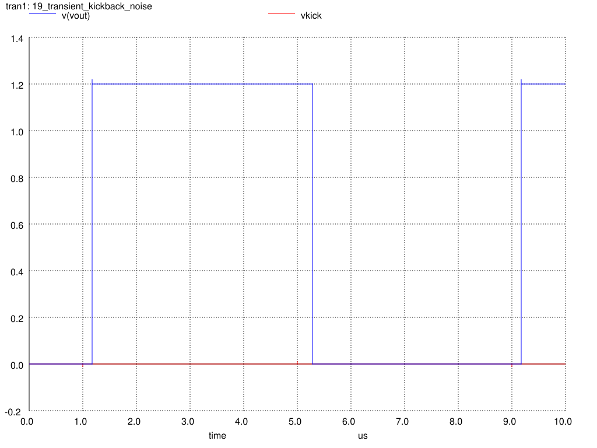

# 19_transient_kickback_noise

**Transient Kickback Noise**

| Field | Value |
| :--- | :--- |
| **Project** | `WINCOMP_Verification_Suite` |
| **Target Block** | `wind_comp` (TOP) |
| **Suite** | General |
| **PDK Corner / Conditions** | `mos_tt` |
| **Hardcopy Target** | `../plots/@name\\.svg` |
| **Data Export** | `write` |
| **Overall Status** | `PASS` |

## 1. Measured Results Metrics

| Parameter | Target Spec | Measured Value | Unit | Status |
| :--- | :--- | :--- | :-: | :-: |
| `vkick_pos` | Minimize peak | **1.10** | mV | PASS |
| `vkick_neg` | Minimize peak | **-0.885** | mV | PASS |

## 2. Engineering Notes

******
** ngspice-47 : Circuit level simulation program
** Compiled with KLU Direct Linear Solver
** The U. C. Berkeley CAD Group
** Copyright 1985-1994, Regents of the University of California.
** Copyright 2001-2026, The ngspice team.
** Please get your ngspice manual from https://ngspice.sourceforge.io/docs.html
** Please file your bug-reports at http://ngspice.sourceforge.net/bugrep.html
** Creation Date: Thu Oct 15 12:58:05 UTC 2026
******
||: No such file or directory

Note: No compatibility mode selected!


Circuit: ** sch_path: /foss/designs/skills/sg13cmos5l_wind_comp/schematic/xschem/wind_comp/wind_comp_tb.sch

Doing analysis at TEMP = 27.000000 and TNOM = 27.000000

Using SPARSE 1.3 as Direct Linear Solver
Note: Starting dynamic gmin stepping
Note: Dynamic gmin stepping completed
 Reference value :  0.00000e+00
No. of Data Rows : 1
ASCII raw file "wind_comp_tb.raw"
Doing analysis at TEMP = 27.000000 and TNOM = 27.000000

Using SPARSE 1.3 as Direct Linear Solver
Note: Starting dynamic gmin stepping
Note: Dynamic gmin stepping completed

Initial Transient Solution
--------------------------

Node                                   Voltage
----                                   -------
xcomp1.x1.votap                        1.06663
vin                                       0.25
xcomp1.x1.tail                        0.427272
vss                                          0
vdd                                        1.2
xcomp1.x1.votan                       0.673842
vh                                         0.9
xcomp1.x1.ibias_en                    0.179032
xcomp1.x1.vom                          0.55445
xcomp1.x1.vop                      4.96767e-05
xcomp1.x1.net2                     4.50246e-05
xcomp1.x1.net1                        0.952043
xcomp1.x1.x4.ibp                      0.653393
xcomp1.x1.x4.vt                       0.954275
xcomp1.x1.x4.n_mrr                    0.394196
xcomp1.x1.en_n                     6.03265e-08
en                                         1.2
xcomp1.net1                                1.2
ibias                                 0.179702
xcomp1.x2.votap                       0.788876
vl                                         0.3
xcomp1.x2.tail                       0.0157698
xcomp1.x2.votan                        0.83457
xcomp1.x2.ibias_en                    0.179032
xcomp1.x2.vom                        0.0400378
xcomp1.x2.vop                         0.357236
xcomp1.x2.net2                             1.2
xcomp1.x2.net1                      4.5122e-05
xcomp1.x2.x4.ibp                      0.653393
xcomp1.x2.x4.vt                       0.552393
xcomp1.x2.x4.n_mrr                      0.4893
xcomp1.x2.en_n                       6.033e-08
xcomp1.net2                        6.02931e-08
xcomp1.x3.net1                             1.2
xcomp1.x3.net2                         1.02641
vout                               5.98745e-08
vin_src                                   0.25
vin#branch                         -1.9082e-13
ven#branch                        -2.32163e-10
vss#branch                         8.62745e-06
vvl#branch                        -8.43728e-13
vvh#branch                        -6.04178e-12
vdd#branch                        -8.62721e-06

 Reference value :  9.99466e-06
No. of Data Rows : 20049
vkick_pos           =  1.09939e-03 at=  1.00175e-06
vkick_neg           =  -8.84951e-04 at=  5.00275e-06
vkick_pos = 1.099390e-03
vkick_neg = -8.84951e-04
ASCII raw file "19.raw"
Warning: Missing charsets in String to FontSet conversion

The file "../plots/19.svg" has the Scalable Vector Graphics format.
ngspice 2 ->

## 3. Principal Code (`principal.spice`)

```spice
.param vdd=1.2 vss=0 vcm=0.6 vrise=0.3
.param vh={vcm+vrise} vl={vcm-vrise}
.param ibias=1u en=1.2 cload=0.1p rload=1G
.param fin=10k vamp=0.6 tnom=27
.param ac_vdd=0 ac_vss=0
.temp {tnom}
.option method=gear
.option savecurrents
.option filetype=ascii
.option color0=white
.option color1=black
.option hcopydevtype=svg
Vdd vdd 0 dc {vdd} ac {ac_vdd}
Vvh vh 0 dc {vh}
Cload vout 0 {cload}
Rload vout vss {rload}
Vvl vl 0 dc {vl}
Ibias vdd ibias dc {ibias}
Vss vss 0 dc {vss} ac {ac_vss}
Ven en 0 dc {en}
```

## 4. Active Code (`active.spice`)

```spice
Vin vin_src 0 pulse(0.25 0.35 1u 1n 1n 4u 8u)
Rsrc vin_src vin 10k
.control
save all
tran 500p 10u
let vkick = v(vin) - v(vin_src)
meas tran vkick_pos MAX vkick FROM=950n TO=2.5u
meas tran vkick_neg MIN vkick FROM=4.95u TO=6.5u
print vkick_pos vkick_neg
write @name\\.raw vkick v(vout)
plot vkick v(vout) title "19_transient_kickback_noise"
set hcopydevtype=svg
hardcopy ../plots/@name\\.svg vkick v(vout) title "19_transient_kickback_noise"
.endc
```

## 5. Xschem `code_shown.sym` Snippets (`xschem_code_shown.txt`)

```text
C {devices/code_shown.sym} -220 -160 0 0 {name=PRINCIPAL_BLOCK
only_toplevel=true
format="tcleval( @value )"
value="
.param vdd=1.2 vss=0 vcm=0.6 vrise=0.3
.param vh={vcm+vrise} vl={vcm-vrise}
.param ibias=1u en=1.2 cload=0.1p rload=1G
.param fin=10k vamp=0.6 tnom=27
.param ac_vdd=0 ac_vss=0
.temp {tnom}
.option method=gear
.option savecurrents
.option filetype=ascii
.option color0=white
.option color1=black
.option hcopydevtype=svg
Vdd vdd 0 dc {vdd} ac {ac_vdd}
Vvh vh 0 dc {vh}
Cload vout 0 {cload}
Rload vout vss {rload}
Vvl vl 0 dc {vl}
Ibias vdd ibias dc {ibias}
Vss vss 0 dc {vss} ac {ac_vss}
Ven en 0 dc {en}
"
place=header}
C {devices/code_shown.sym} -220 80 0 0 {name=19_transient_kickback_noise
only_toplevel=true
format="tcleval( @value )"
value="
Vin vin_src 0 pulse(0.25 0.35 1u 1n 1n 4u 8u)
Rsrc vin_src vin 10k
.control
save all
tran 500p 10u
let vkick = v(vin) - v(vin_src)
meas tran vkick_pos MAX vkick FROM=950n TO=2.5u
meas tran vkick_neg MIN vkick FROM=4.95u TO=6.5u
print vkick_pos vkick_neg
write @name\\.raw vkick v(vout)
plot vkick v(vout) title \"19_transient_kickback_noise\"
set hcopydevtype=svg
hardcopy ../plots/@name\\.svg vkick v(vout) title \"19_transient_kickback_noise\"
.endc
"
place=end}
```

## 6. Result Figures

### Figure 1: 19_transient_kickback_noise — 19.svg


