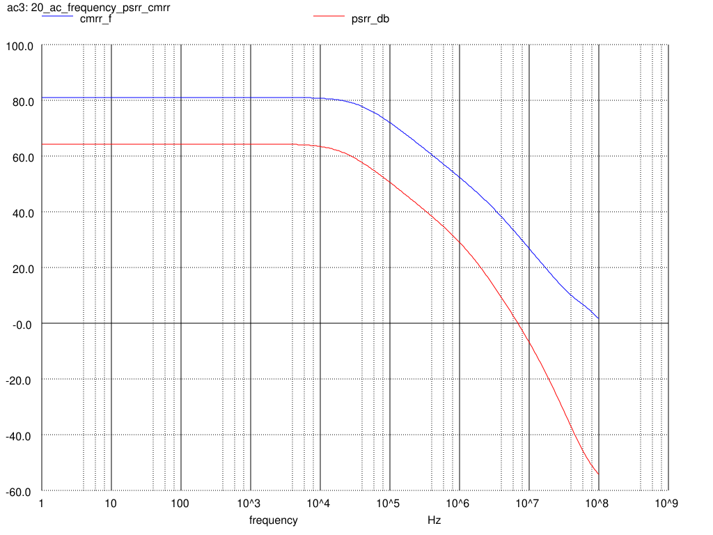

# 20_ac_frequency_psrr_cmrr

**AC Frequency-Dependent PSRR & CMRR**

| Field | Value |
| :--- | :--- |
| **Project** | `WINCOMP_Verification_Suite` |
| **Target Block** | `wind_comp` (TOP) |
| **Suite** | General |
| **PDK Corner / Conditions** | `mos_tt` |
| **Hardcopy Target** | `../plots/@name\\.svg` |
| **Data Export** | `write` |
| **Overall Status** | `PASS` |

## 1. Measured Results Metrics

| Parameter | Target Spec | Measured Value | Unit | Status |
| :--- | :--- | :--- | :-: | :-: |
| `PSRR(1kHz / 1MHz)` | ≥ 35 low-freq | **64.33 / 29.02** | dB | PASS |
| `CMRR(1kHz / 1MHz)` | ≥ 45 low-freq | **81.04 / 52.34** | dB | PASS |

## 2. Engineering Notes

******
** ngspice-47 : Circuit level simulation program
** Compiled with KLU Direct Linear Solver
** The U. C. Berkeley CAD Group
** Copyright 1985-1994, Regents of the University of California.
** Copyright 2001-2026, The ngspice team.
** Please get your ngspice manual from https://ngspice.sourceforge.io/docs.html
** Please file your bug-reports at http://ngspice.sourceforge.net/bugrep.html
** Creation Date: Thu Oct 15 12:58:05 UTC 2026
******
||: No such file or directory

Note: No compatibility mode selected!


Circuit: ** sch_path: /foss/designs/skills/sg13cmos5l_wind_comp/schematic/xschem/wind_comp/wind_comp_pex_tb.sch

Doing analysis at TEMP = 27.000000 and TNOM = 27.000000

Using SPARSE 1.3 as Direct Linear Solver
Warning: singular matrix:  check node x1.slot4_wrapper_0.dig_in[5]

Note: Starting dynamic gmin stepping
Warning: singular matrix:  check node x1.slot4_wrapper_0.ibias1

Warning: Dynamic gmin stepping failed
Note: Starting true gmin stepping
Warning: singular matrix:  check node x1.slot4_wrapper_0.ibias1

Warning: singular matrix:  check node x1.slot4_wrapper_0.ibias1

Warning: singular matrix:  check node x1.slot4_wrapper_0.ibias1

Warning: singular matrix:  check node x1.slot4_wrapper_0.ibias1

Warning: True gmin stepping failed
Note: Starting source stepping
Warning: source stepping failed
Note: Transient op started
Note: Transient op finished successfully
 Reference value :  0.00000e+00
No. of Data Rows : 1
ASCII raw file "wind_comp_pex_tb.raw"
Doing analysis at TEMP = 27.000000 and TNOM = 27.000000

Using SPARSE 1.3 as Direct Linear Solver
Note: Starting dynamic gmin stepping
Warning: singular matrix:  check node x1.m5_97260_2558#

Warning: Dynamic gmin stepping failed
Note: Starting true gmin stepping
Warning: singular matrix:  check node x1.m5_97260_2558#

Warning: singular matrix:  check node x1.m5_97260_2558#

Warning: singular matrix:  check node x1.m5_97260_2558#

Warning: singular matrix:  check node x1.m5_97260_2558#

Warning: singular matrix:  check node x1.m5_97260_2558#

Warning: True gmin stepping failed
Note: Starting source stepping
Warning: source stepping failed
Note: Transient op started
Note: Transient op finished successfully
 Reference value :  1.99526e+07
No. of Data Rows : 401
Doing analysis at TEMP = 27.000000 and TNOM = 27.000000

Using SPARSE 1.3 as Direct Linear Solver
Note: Starting dynamic gmin stepping
Warning: singular matrix:  check node x1.m5_97260_2558#

Warning: Dynamic gmin stepping failed
Note: Starting true gmin stepping
Warning: singular matrix:  check node x1.m5_97260_2558#

Warning: singular matrix:  check node x1.m5_97260_2558#

Warning: singular matrix:  check node x1.m5_97260_2558#

Warning: singular matrix:  check node x1.m5_97260_2558#

Warning: singular matrix:  check node x1.m5_97260_2558#

Warning: True gmin stepping failed
Note: Starting source stepping
Warning: source stepping failed
Note: Transient op started
Note: Transient op finished successfully
 Reference value :  2.51189e+07
No. of Data Rows : 401
Doing analysis at TEMP = 27.000000 and TNOM = 27.000000

Using SPARSE 1.3 as Direct Linear Solver
Note: Starting dynamic gmin stepping
Warning: singular matrix:  check node x1.m5_97260_2558#

Warning: Dynamic gmin stepping failed
Note: Starting true gmin stepping
Warning: singular matrix:  check node x1.m5_97260_2558#

Warning: singular matrix:  check node x1.m5_97260_2558#

Warning: singular matrix:  check node x1.m5_97260_2558#

Warning: singular matrix:  check node x1.m5_97260_2558#

Warning: singular matrix:  check node x1.m5_97260_2558#

Warning: True gmin stepping failed
Note: Starting source stepping
Warning: source stepping failed
Note: Transient op started
Note: Transient op finished successfully
 Reference value :  2.51189e+07
No. of Data Rows : 401
psrr_1k             =  6.43316e+01
psrr_1m             =  2.90166e+01
cmrr_1k             =  8.10393e+01
cmrr_1m             =  5.23383e+01
psrr_1k = 6.433162e+01
psrr_1m = 2.901655e+01
cmrr_1k = 8.103933e+01
cmrr_1m = 5.233833e+01
ASCII raw file "20.raw"
Warning: Missing charsets in String to FontSet conversion

The file "../plots/20.svg" has the Scalable Vector Graphics format.
ngspice 2 ->

## 3. Principal Code (`principal.spice`)

```spice
.param vdd=1.2 vss=0 vcm=0.6 vrise=0.3
.param vh={vcm+vrise} vl={vcm-vrise}
.param ibias=1u en=1.2 cload=0.1p rload=1G
.param fin=10k vamp=0.6 tnom=27
.param ac_vdd=0 ac_vss=0
.temp {tnom}
.option method=gear
.option savecurrents
.option filetype=ascii
.option color0=white
.option color1=black
.option hcopydevtype=svg
Vdd vdd 0 dc {vdd} ac {ac_vdd}
Vvh vh 0 dc {vh}
Cload vout 0 {cload}
Rload vout vss {rload}
Vvl vl 0 dc {vl}
Ibias vdd ibias dc {ibias}
Vss vss 0 dc {vss} ac {ac_vss}
Ven en 0 dc {en}
```

## 4. Active Code (`active.spice`)

```spice
Vin vin 0 dc {vl} ac 1
.control
save all
ac dec 50 1 100Meg
let adm = mag(v(x1.wind_comp_0.comparator_1.sg13cmos5l_inv_16_0.a))
set p_dm = $curplot
alter @vin[acmag] = 0
alter @vvl[acmag] = 0
alter @vdd[acmag] = 1
ac dec 50 1 100Meg
let avdd = mag(v(x1.wind_comp_0.comparator_1.sg13cmos5l_inv_16_0.a))
let psrr_f = 20 * log10({$p_dm}.adm / avdd)
set p_dd = $curplot
alter @vdd[acmag] = 0
alter @vin[acmag] = 1
alter @vvl[acmag] = 1
ac dec 50 1 100Meg
let acm = mag(v(x1.wind_comp_0.comparator_1.sg13cmos5l_inv_16_0.a))
let cmrr_f = 20 * log10({$p_dm}.adm / acm)
let psrr_db = {$p_dd}.psrr_f
meas ac psrr_1k FIND psrr_db AT=1k
meas ac psrr_1m FIND psrr_db AT=1Meg
meas ac cmrr_1k FIND cmrr_f AT=1k
meas ac cmrr_1m FIND cmrr_f AT=1Meg
print psrr_1k psrr_1m cmrr_1k cmrr_1m
write @name\\.raw psrr_db cmrr_f
plot psrr_db cmrr_f title "20_ac_frequency_psrr_cmrr"
set hcopydevtype=svg
hardcopy ../plots/@name\\.svg psrr_db cmrr_f title "20_ac_frequency_psrr_cmrr"
.endc
```

## 5. Xschem `code_shown.sym` Snippets (`xschem_code_shown.txt`)

```text
C {devices/code_shown.sym} -220 -160 0 0 {name=PRINCIPAL_BLOCK
only_toplevel=true
format="tcleval( @value )"
value="
.param vdd=1.2 vss=0 vcm=0.6 vrise=0.3
.param vh={vcm+vrise} vl={vcm-vrise}
.param ibias=1u en=1.2 cload=0.1p rload=1G
.param fin=10k vamp=0.6 tnom=27
.param ac_vdd=0 ac_vss=0
.temp {tnom}
.option method=gear
.option savecurrents
.option filetype=ascii
.option color0=white
.option color1=black
.option hcopydevtype=svg
Vdd vdd 0 dc {vdd} ac {ac_vdd}
Vvh vh 0 dc {vh}
Cload vout 0 {cload}
Rload vout vss {rload}
Vvl vl 0 dc {vl}
Ibias vdd ibias dc {ibias}
Vss vss 0 dc {vss} ac {ac_vss}
Ven en 0 dc {en}
"
place=header}
C {devices/code_shown.sym} -220 80 0 0 {name=20_ac_frequency_psrr_cmrr
only_toplevel=true
format="tcleval( @value )"
value="
Vin vin 0 dc {vl} ac 1
.control
save all
ac dec 50 1 100Meg
let adm = mag(v(x1.wind_comp_0.comparator_1.sg13cmos5l_inv_16_0.a))
set p_dm = $curplot
alter @vin[acmag] = 0
alter @vvl[acmag] = 0
alter @vdd[acmag] = 1
ac dec 50 1 100Meg
let avdd = mag(v(x1.wind_comp_0.comparator_1.sg13cmos5l_inv_16_0.a))
let psrr_f = 20 * log10({$p_dm}.adm / avdd)
set p_dd = $curplot
alter @vdd[acmag] = 0
alter @vin[acmag] = 1
alter @vvl[acmag] = 1
ac dec 50 1 100Meg
let acm = mag(v(x1.wind_comp_0.comparator_1.sg13cmos5l_inv_16_0.a))
let cmrr_f = 20 * log10({$p_dm}.adm / acm)
let psrr_db = {$p_dd}.psrr_f
meas ac psrr_1k FIND psrr_db AT=1k
meas ac psrr_1m FIND psrr_db AT=1Meg
meas ac cmrr_1k FIND cmrr_f AT=1k
meas ac cmrr_1m FIND cmrr_f AT=1Meg
print psrr_1k psrr_1m cmrr_1k cmrr_1m
write @name\\.raw psrr_db cmrr_f
plot psrr_db cmrr_f title \"20_ac_frequency_psrr_cmrr\"
set hcopydevtype=svg
hardcopy ../plots/@name\\.svg psrr_db cmrr_f title \"20_ac_frequency_psrr_cmrr\"
.endc
"
place=end}
```

## 6. Result Figures

### Figure 1: 20_ac_frequency_psrr_cmrr — 20_ac_frequency_psrr_cmrr.svg


