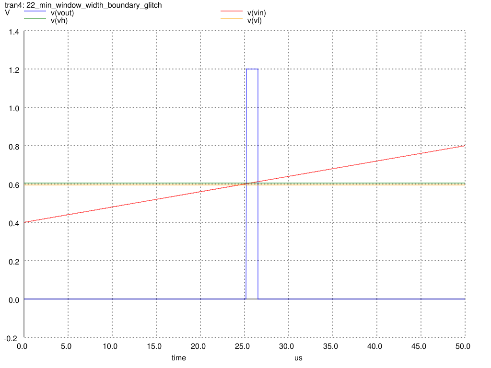

# 22_min_window_width_boundary_glitch

**Minimum Window Width & Boundary Glitch Test**

| Field | Value |
| :--- | :--- |
| **Project** | `WINCOMP_Verification_Suite` |
| **Target Block** | `wind_comp` (TOP) |
| **Suite** | General |
| **PDK Corner / Conditions** | `mos_tt` |
| **Hardcopy Target** | `../plots/@name\\.svg` |
| **Data Export** | `write` |
| **Overall Status** | `PASS` |

## 1. Measured Results Metrics

| Parameter | Target Spec | Measured Value | Unit | Status |
| :--- | :--- | :--- | :-: | :-: |
| `Min Window (2×vrise)` | Clean full-swing | **10 (vr=5m, pw=1.33 µs)** | mV | PASS |
| `Boundary Glitches` | 0 false pulses | **0 (1.20 V clean peak)** | count | PASS |

## 2. Engineering Notes

******
** ngspice-47 : Circuit level simulation program
** Compiled with KLU Direct Linear Solver
** The U. C. Berkeley CAD Group
** Copyright 1985-1994, Regents of the University of California.
** Copyright 2001-2026, The ngspice team.
** Please get your ngspice manual from https://ngspice.sourceforge.io/docs.html
** Please file your bug-reports at http://ngspice.sourceforge.net/bugrep.html
** Creation Date: Thu Oct 15 12:58:05 UTC 2026
******
||: No such file or directory

Note: No compatibility mode selected!


Circuit: ** sch_path: /foss/designs/skills/sg13cmos5l_wind_comp/schematic/xschem/wind_comp/wind_comp_tb.sch

Doing analysis at TEMP = 27.000000 and TNOM = 27.000000

Using SPARSE 1.3 as Direct Linear Solver
Note: Starting dynamic gmin stepping
Note: Dynamic gmin stepping completed
 Reference value :  0.00000e+00
No. of Data Rows : 1
ASCII raw file "wind_comp_tb.raw"
Reset re-loads circuit ** sch_path: /foss/designs/skills/sg13cmos5l_wind_comp/schematic/xschem/wind_comp/wind_comp_tb.sch

Circuit: ** sch_path: /foss/designs/skills/sg13cmos5l_wind_comp/schematic/xschem/wind_comp/wind_comp_tb.sch

Doing analysis at TEMP = 27.000000 and TNOM = 27.000000

Using SPARSE 1.3 as Direct Linear Solver
Note: Starting dynamic gmin stepping
Note: Dynamic gmin stepping completed

Initial Transient Solution
--------------------------

Node                                   Voltage
----                                   -------
xcomp1.x1.votap                       0.918553
vin                                        0.4
xcomp1.x1.tail                        0.224028
vss                                          0
vdd                                        1.2
xcomp1.x1.votan                       0.689221
vh                                        0.65
xcomp1.x1.ibias_en                    0.179032
xcomp1.x1.vom                         0.527367
xcomp1.x1.vop                        0.0016863
xcomp1.x1.net2                     8.71444e-05
xcomp1.x1.net1                        0.928935
xcomp1.x1.x4.ibp                      0.653393
xcomp1.x1.x4.vt                       0.931288
xcomp1.x1.x4.n_mrr                    0.394778
xcomp1.x1.en_n                     6.03265e-08
en                                         1.2
xcomp1.net1                                1.2
ibias                                 0.179702
xcomp1.x2.votap                       0.703432
vl                                        0.55
xcomp1.x2.tail                         0.15062
xcomp1.x2.votan                       0.838243
xcomp1.x2.ibias_en                    0.179032
xcomp1.x2.vom                        0.0164572
xcomp1.x2.vop                         0.502495
xcomp1.x2.net2                             1.2
xcomp1.x2.net1                     3.13912e-05
xcomp1.x2.x4.ibp                      0.653393
xcomp1.x2.x4.vt                       0.539523
xcomp1.x2.x4.n_mrr                     0.48937
xcomp1.x2.en_n                       6.033e-08
xcomp1.net2                        6.02931e-08
xcomp1.x3.net1                             1.2
xcomp1.x3.net2                         1.02641
vout                               5.98745e-08
vin#branch                          -4.272e-13
ven#branch                        -2.32171e-10
vss#branch                         9.89031e-06
vvl#branch                        -3.19991e-12
vvh#branch                        -4.06652e-12
vdd#branch                        -9.89007e-06

 Reference value :  4.87483e-05
No. of Data Rows : 1030
vout_pk             =  1.20458e+00 at=  1.95848e-05
pw                  =  1.25591e-05 targ=  3.21392e-05 trig=  1.95801e-05
Reset re-loads circuit ** sch_path: /foss/designs/skills/sg13cmos5l_wind_comp/schematic/xschem/wind_comp/wind_comp_tb.sch

Circuit: ** sch_path: /foss/designs/skills/sg13cmos5l_wind_comp/schematic/xschem/wind_comp/wind_comp_tb.sch

Doing analysis at TEMP = 27.000000 and TNOM = 27.000000

Using SPARSE 1.3 as Direct Linear Solver
Note: Starting dynamic gmin stepping
Note: Dynamic gmin stepping completed

Initial Transient Solution
--------------------------

Node                                   Voltage
----                                   -------
xcomp1.x1.votap                       0.896743
vin                                        0.4
xcomp1.x1.tail                        0.204582
vss                                          0
vdd                                        1.2
xcomp1.x1.votan                       0.691668
vh                                       0.625
xcomp1.x1.ibias_en                    0.179032
xcomp1.x1.vom                         0.523073
xcomp1.x1.vop                       0.00324728
xcomp1.x1.net2                     9.68307e-05
xcomp1.x1.net1                        0.925257
xcomp1.x1.x4.ibp                      0.653393
xcomp1.x1.x4.vt                       0.927636
xcomp1.x1.x4.n_mrr                    0.394857
xcomp1.x1.en_n                     6.03265e-08
en                                         1.2
xcomp1.net1                                1.2
ibias                                 0.179702
xcomp1.x2.votap                       0.698607
vl                                       0.575
xcomp1.x2.tail                        0.167715
xcomp1.x2.votan                       0.856435
xcomp1.x2.ibias_en                    0.179032
xcomp1.x2.vom                        0.0101873
xcomp1.x2.vop                         0.510923
xcomp1.x2.net2                             1.2
xcomp1.x2.net1                     3.13694e-05
xcomp1.x2.x4.ibp                      0.653393
xcomp1.x2.x4.vt                        0.53657
xcomp1.x2.x4.n_mrr                    0.489382
xcomp1.x2.en_n                       6.033e-08
xcomp1.net2                        6.02931e-08
xcomp1.x3.net1                             1.2
xcomp1.x3.net2                         1.02641
vout                               5.98745e-08
vin#branch                        -3.42421e-13
ven#branch                        -2.32171e-10
vss#branch                         9.97371e-06
vvl#branch                        -3.44318e-12
vvh#branch                          -3.874e-12
vdd#branch                        -9.97347e-06

 Reference value :  4.94972e-05
No. of Data Rows : 1026
vout_pk             =  1.20227e+00 at=  2.27094e-05
pw                  =  6.31854e-06 targ=  2.90157e-05 trig=  2.26972e-05
Reset re-loads circuit ** sch_path: /foss/designs/skills/sg13cmos5l_wind_comp/schematic/xschem/wind_comp/wind_comp_tb.sch

Circuit: ** sch_path: /foss/designs/skills/sg13cmos5l_wind_comp/schematic/xschem/wind_comp/wind_comp_tb.sch

Doing analysis at TEMP = 27.000000 and TNOM = 27.000000

Using SPARSE 1.3 as Direct Linear Solver
Note: Starting dynamic gmin stepping
Note: Dynamic gmin stepping completed

Initial Transient Solution
--------------------------

Node                                   Voltage
----                                   -------
xcomp1.x1.votap                       0.884132
vin                                        0.4
xcomp1.x1.tail                        0.193195
vss                                          0
vdd                                        1.2
xcomp1.x1.votan                        0.69342
vh                                        0.61
xcomp1.x1.ibias_en                    0.179032
xcomp1.x1.vom                         0.520002
xcomp1.x1.vop                        0.0047007
xcomp1.x1.net2                     0.000104424
xcomp1.x1.net1                        0.922625
xcomp1.x1.x4.ibp                      0.653393
xcomp1.x1.x4.vt                       0.925023
xcomp1.x1.x4.n_mrr                    0.394912
xcomp1.x1.en_n                     6.03265e-08
en                                         1.2
xcomp1.net1                                1.2
ibias                                 0.179702
xcomp1.x2.votap                       0.696177
vl                                        0.59
xcomp1.x2.tail                         0.17843
xcomp1.x2.votan                       0.867993
xcomp1.x2.ibias_en                    0.179032
xcomp1.x2.vom                        0.0074127
xcomp1.x2.vop                         0.515174
xcomp1.x2.net2                             1.2
xcomp1.x2.net1                     3.13619e-05
xcomp1.x2.x4.ibp                      0.653393
xcomp1.x2.x4.vt                       0.535324
xcomp1.x2.x4.n_mrr                    0.489387
xcomp1.x2.en_n                       6.033e-08
xcomp1.net2                        6.02931e-08
xcomp1.x3.net1                             1.2
xcomp1.x3.net2                         1.02641
vout                               5.98745e-08
vin#branch                        -3.17434e-13
ven#branch                        -2.32171e-10
vss#branch                         1.00411e-05
vvl#branch                        -3.58007e-12
vvh#branch                        -3.75211e-12
vdd#branch                        -1.00408e-05

 Reference value :  4.86215e-05
No. of Data Rows : 1031
vout_pk             =  1.20496e+00 at=  2.45759e-05
pw                  =  2.57434e-06 targ=  2.71460e-05 trig=  2.45716e-05
Reset re-loads circuit ** sch_path: /foss/designs/skills/sg13cmos5l_wind_comp/schematic/xschem/wind_comp/wind_comp_tb.sch

Circuit: ** sch_path: /foss/designs/skills/sg13cmos5l_wind_comp/schematic/xschem/wind_comp/wind_comp_tb.sch

Doing analysis at TEMP = 27.000000 and TNOM = 27.000000

Using SPARSE 1.3 as Direct Linear Solver
Note: Starting dynamic gmin stepping
Note: Dynamic gmin stepping completed

Initial Transient Solution
--------------------------

Node                                   Voltage
----                                   -------
xcomp1.x1.votap                       0.880022
vin                                        0.4
xcomp1.x1.tail                        0.189456
vss                                          0
vdd                                        1.2
xcomp1.x1.votan                       0.694061
vh                                       0.605
xcomp1.x1.ibias_en                    0.179032
xcomp1.x1.vom                         0.518878
xcomp1.x1.vop                       0.00529242
xcomp1.x1.net2                      0.00010735
xcomp1.x1.net1                        0.921661
xcomp1.x1.x4.ibp                      0.653393
xcomp1.x1.x4.vt                       0.924067
xcomp1.x1.x4.n_mrr                    0.394932
xcomp1.x1.en_n                     6.03265e-08
en                                         1.2
xcomp1.net1                                1.2
ibias                                 0.179702
xcomp1.x2.votap                       0.695438
vl                                       0.595
xcomp1.x2.tail                        0.182072
xcomp1.x2.votan                       0.871951
xcomp1.x2.ibias_en                    0.179032
xcomp1.x2.vom                         0.006632
xcomp1.x2.vop                         0.516467
xcomp1.x2.net2                             1.2
xcomp1.x2.net1                       3.136e-05
xcomp1.x2.x4.ibp                      0.653393
xcomp1.x2.x4.vt                       0.534981
xcomp1.x2.x4.n_mrr                    0.489388
xcomp1.x2.en_n                       6.033e-08
xcomp1.net2                        6.02931e-08
xcomp1.x3.net1                             1.2
xcomp1.x3.net2                         1.02641
vout                               5.98745e-08
vin#branch                        -3.13818e-13
ven#branch                        -2.32171e-10
vss#branch                         1.00672e-05
vvl#branch                        -3.62417e-12
vvh#branch                        -3.71013e-12
vdd#branch                         -1.0067e-05

 Reference value :  4.98144e-05
No. of Data Rows : 1027
vout_pk             =  1.20234e+00 at=  2.52039e-05
pw                  =  1.33019e-06 targ=  2.65229e-05 trig=  2.51927e-05
ASCII raw file "22.raw"
Warning: Missing charsets in String to FontSet conversion

The file "../plots/22.svg" has the Scalable Vector Graphics format.
ngspice 2 ->

## 3. Principal Code (`principal.spice`)

```spice
.param vdd=1.2 vss=0 vcm=0.6 vrise=0.3
.param vh={vcm+vrise} vl={vcm-vrise}
.param ibias=1u en=1.2 cload=0.1p rload=1G
.param fin=10k vamp=0.6 tnom=27
.param ac_vdd=0 ac_vss=0
.temp {tnom}
.option method=gear
.option savecurrents
.option filetype=ascii
.option color0=white
.option color1=black
.option hcopydevtype=svg
Vdd vdd 0 dc {vdd} ac {ac_vdd}
Vvh vh 0 dc {vh}
Cload vout 0 {cload}
Rload vout vss {rload}
Vvl vl 0 dc {vl}
Ibias vdd ibias dc {ibias}
Vss vss 0 dc {vss} ac {ac_vss}
Ven en 0 dc {en}
```

## 4. Active Code (`active.spice`)

```spice
Vin vin 0 pwl(0 0.4 50u 0.8)
.control
save all
foreach vr 50m 25m 10m 5m
  alterparam vrise=$vr
  reset
  save all
  tran 50n 50u
  meas tran vout_pk MAX v(vout)
  meas tran pw TRIG v(vout) VAL=0.6 RISE=1 TARG v(vout) VAL=0.6 FALL=1
  echo $vr $&vout_pk $&pw >> @name\\.txt
end
write @name\\.raw v(vin) v(vout) v(vl) v(vh)
plot v(vin) v(vout) v(vl) v(vh) title "22_min_window_width_boundary_glitch"
set hcopydevtype=svg
hardcopy ../plots/@name\\.svg v(vin) v(vout) v(vl) v(vh) title "22_min_window_width_boundary_glitch"
.endc
```

## 5. Xschem `code_shown.sym` Snippets (`xschem_code_shown.txt`)

```text
C {devices/code_shown.sym} -220 -160 0 0 {name=PRINCIPAL_BLOCK
only_toplevel=true
format="tcleval( @value )"
value="
.param vdd=1.2 vss=0 vcm=0.6 vrise=0.3
.param vh={vcm+vrise} vl={vcm-vrise}
.param ibias=1u en=1.2 cload=0.1p rload=1G
.param fin=10k vamp=0.6 tnom=27
.param ac_vdd=0 ac_vss=0
.temp {tnom}
.option method=gear
.option savecurrents
.option filetype=ascii
.option color0=white
.option color1=black
.option hcopydevtype=svg
Vdd vdd 0 dc {vdd} ac {ac_vdd}
Vvh vh 0 dc {vh}
Cload vout 0 {cload}
Rload vout vss {rload}
Vvl vl 0 dc {vl}
Ibias vdd ibias dc {ibias}
Vss vss 0 dc {vss} ac {ac_vss}
Ven en 0 dc {en}
"
place=header}
C {devices/code_shown.sym} -220 80 0 0 {name=22_min_window_width_boundary_glitch
only_toplevel=true
format="tcleval( @value )"
value="
Vin vin 0 pwl(0 0.4 50u 0.8)
.control
save all
foreach vr 50m 25m 10m 5m
  alterparam vrise=$vr
  reset
  save all
  tran 50n 50u
  meas tran vout_pk MAX v(vout)
  meas tran pw TRIG v(vout) VAL=0.6 RISE=1 TARG v(vout) VAL=0.6 FALL=1
  echo $vr $&vout_pk $&pw >> @name\\.txt
end
write @name\\.raw v(vin) v(vout) v(vl) v(vh)
plot v(vin) v(vout) v(vl) v(vh) title \"22_min_window_width_boundary_glitch\"
set hcopydevtype=svg
hardcopy ../plots/@name\\.svg v(vin) v(vout) v(vl) v(vh) title \"22_min_window_width_boundary_glitch\"
.endc
"
place=end}
```

## 6. Result Figures

### Figure 1: 22_min_window_width_boundary_glitch — 22_min_window_width_boundary_glitch.svg


