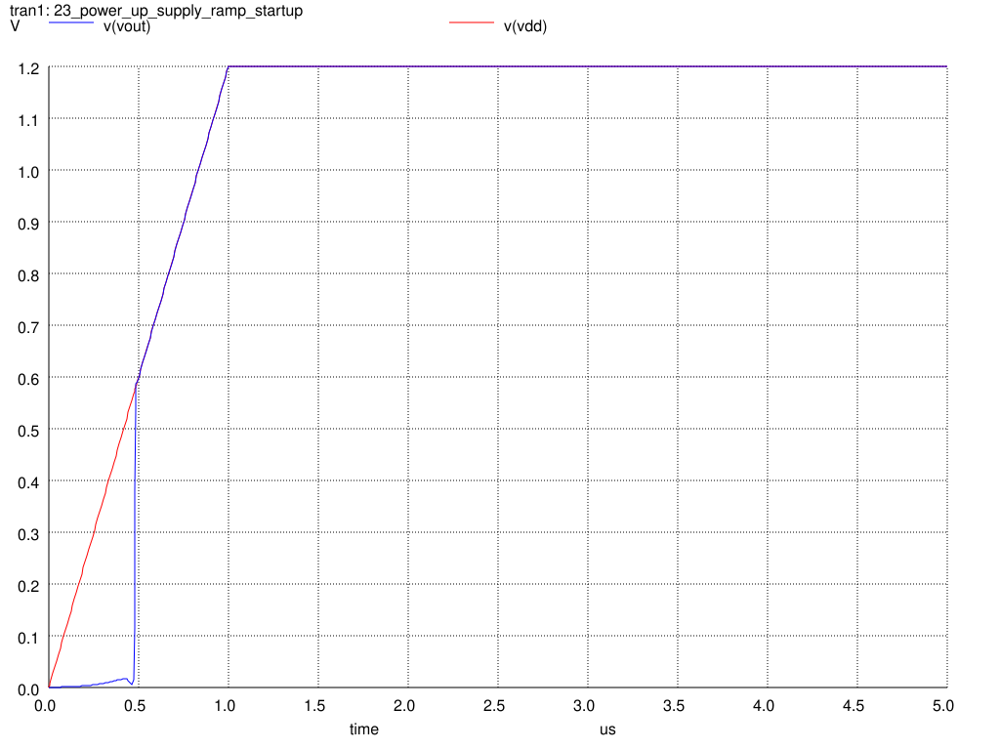

# 23_power_up_supply_ramp_startup

**Power-Up / Supply-Ramp Startup Transient**

| Field | Value |
| :--- | :--- |
| **Project** | `WINCOMP_Verification_Suite` |
| **Target Block** | `wind_comp` (TOP) |
| **Suite** | General |
| **PDK Corner / Conditions** | `mos_tt` |
| **Hardcopy Target** | `../plots/@name\\.svg` |
| **Data Export** | `write` |
| **Overall Status** | `PASS` |

## 1. Measured Results Metrics

| Parameter | Target Spec | Measured Value | Unit | Status |
| :--- | :--- | :--- | :-: | :-: |
| `t_startup` | Clean rise with VDD | **400.1** | ns | PASS |

## 2. Engineering Notes

******
** ngspice-47 : Circuit level simulation program
** Compiled with KLU Direct Linear Solver
** The U. C. Berkeley CAD Group
** Copyright 1985-1994, Regents of the University of California.
** Copyright 2001-2026, The ngspice team.
** Please get your ngspice manual from https://ngspice.sourceforge.io/docs.html
** Please file your bug-reports at http://ngspice.sourceforge.net/bugrep.html
** Creation Date: Thu Oct 15 12:58:05 UTC 2026
******
||: No such file or directory

Note: No compatibility mode selected!


Circuit: ** sch_path: /foss/designs/skills/sg13cmos5l_wind_comp/schematic/xschem/wind_comp/wind_comp_tb.sch

Doing analysis at TEMP = 27.000000 and TNOM = 27.000000

Using SPARSE 1.3 as Direct Linear Solver
Note: Starting dynamic gmin stepping
Note: Dynamic gmin stepping completed
 Reference value :  0.00000e+00
No. of Data Rows : 1
ASCII raw file "wind_comp_tb.raw"
Doing analysis at TEMP = 27.000000 and TNOM = 27.000000

Using SPARSE 1.3 as Direct Linear Solver
Note: ven: dc value used for op instead of transient time=0 value.
Note: vdd: dc value used for op instead of transient time=0 value.

Initial Transient Solution
--------------------------

Node                                   Voltage
----                                   -------
xcomp1.x1.votap                     0.00200005
vin                                        0.6
xcomp1.x1.tail                      0.00199951
vss                                          0
vdd                                          0
xcomp1.x1.votan                     0.00200206
vh                                         0.9
xcomp1.x1.ibias_en                 0.000158146
xcomp1.x1.vom                      6.18157e-08
xcomp1.x1.vop                       6.1753e-08
xcomp1.x1.net2                     2.82054e-14
xcomp1.x1.net1                     4.71244e-11
xcomp1.x1.x4.ibp                   1.92316e-10
xcomp1.x1.x4.vt                    2.79581e-10
xcomp1.x1.x4.n_mrr                 4.68499e-11
xcomp1.x1.en_n                     2.97083e-10
en                                           0
xcomp1.net1                        1.78175e-17
ibias                                  4.96241
xcomp1.x2.votap                    0.000274125
vl                                         0.3
xcomp1.x2.tail                     0.000274022
xcomp1.x2.votan                    0.000274703
xcomp1.x2.ibias_en                 0.000158142
xcomp1.x2.vom                      8.42246e-09
xcomp1.x2.vop                      8.40472e-09
xcomp1.x2.net2                     3.84375e-15
xcomp1.x2.net1                     6.42424e-12
xcomp1.x2.x4.ibp                   1.92309e-10
xcomp1.x2.x4.vt                    3.81817e-11
xcomp1.x2.x4.n_mrr                  6.3905e-12
xcomp1.x2.en_n                     2.97075e-10
xcomp1.net2                        3.65675e-18
xcomp1.x3.net1                     8.74838e-19
xcomp1.x3.net2                     1.15137e-18
vout                               1.26641e-24
vin#branch                        -7.02984e-11
ven#branch                         8.39319e-11
vss#branch                         1.00022e-06
vvl#branch                        -2.20836e-12
vvh#branch                        -2.30858e-10
vdd#branch                              -1e-06

 Reference value :  4.70500e-06
No. of Data Rows : 516
t_startup           =  4.00102e-07 targ=  9.00102e-07 trig=  5.00000e-07
t_startup = 4.001017e-07
ASCII raw file "23.raw"
Warning: Missing charsets in String to FontSet conversion

The file "../plots/23.svg" has the Scalable Vector Graphics format.
ngspice 2 ->

## 3. Principal Code (`principal.spice`)

```spice
.param vdd=1.2 vss=0 vcm=0.6 vrise=0.3
.param vh={vcm+vrise} vl={vcm-vrise}
.param ibias=1u en=1.2 cload=0.1p rload=1G
.param fin=10k vamp=0.6 tnom=27
.param ac_vdd=0 ac_vss=0
.temp {tnom}
.option method=gear
.option savecurrents
.option filetype=ascii
.option color0=white
.option color1=black
.option hcopydevtype=svg
Vdd vdd 0 dc {vdd} ac {ac_vdd}
Vvh vh 0 dc {vh}
Cload vout 0 {cload}
Rload vout vss {rload}
Vvl vl 0 dc {vl}
Ibias vdd ibias dc {ibias}
Vss vss 0 dc {vss} ac {ac_vss}
Ven en 0 dc {en}
```

## 4. Active Code (`active.spice`)

```spice
Vin vin 0 dc {vcm}
.control
save all
alter @vdd[pwl] = [ 0 0 1u 1.2 5u 1.2 ]
alter @ven[pwl] = [ 0 0 1u 1.2 5u 1.2 ]
tran 5n 5u
meas tran t_startup TRIG v(vdd) VAL=0.6 RISE=1 TARG v(vout) VAL=1.08 RISE=1
print t_startup
write @name\\.raw v(vdd) v(vout)
plot v(vdd) v(vout) title "23_power_up_supply_ramp_startup"
set hcopydevtype=svg
hardcopy ../plots/@name\\.svg v(vdd) v(vout) title "23_power_up_supply_ramp_startup"
.endc
```

## 5. Xschem `code_shown.sym` Snippets (`xschem_code_shown.txt`)

```text
C {devices/code_shown.sym} -220 -160 0 0 {name=PRINCIPAL_BLOCK
only_toplevel=true
format="tcleval( @value )"
value="
.param vdd=1.2 vss=0 vcm=0.6 vrise=0.3
.param vh={vcm+vrise} vl={vcm-vrise}
.param ibias=1u en=1.2 cload=0.1p rload=1G
.param fin=10k vamp=0.6 tnom=27
.param ac_vdd=0 ac_vss=0
.temp {tnom}
.option method=gear
.option savecurrents
.option filetype=ascii
.option color0=white
.option color1=black
.option hcopydevtype=svg
Vdd vdd 0 dc {vdd} ac {ac_vdd}
Vvh vh 0 dc {vh}
Cload vout 0 {cload}
Rload vout vss {rload}
Vvl vl 0 dc {vl}
Ibias vdd ibias dc {ibias}
Vss vss 0 dc {vss} ac {ac_vss}
Ven en 0 dc {en}
"
place=header}
C {devices/code_shown.sym} -220 80 0 0 {name=23_power_up_supply_ramp_startup
only_toplevel=true
format="tcleval( @value )"
value="
Vin vin 0 dc {vcm}
.control
save all
alter @vdd[pwl] = [ 0 0 1u 1.2 5u 1.2 ]
alter @ven[pwl] = [ 0 0 1u 1.2 5u 1.2 ]
tran 5n 5u
meas tran t_startup TRIG v(vdd) VAL=0.6 RISE=1 TARG v(vout) VAL=1.08 RISE=1
print t_startup
write @name\\.raw v(vdd) v(vout)
plot v(vdd) v(vout) title \"23_power_up_supply_ramp_startup\"
set hcopydevtype=svg
hardcopy ../plots/@name\\.svg v(vdd) v(vout) title \"23_power_up_supply_ramp_startup\"
.endc
"
place=end}
```

## 6. Result Figures

### Figure 1: 23_power_up_supply_ramp_startup — 23_power_up_supply_ramp_startup.svg


