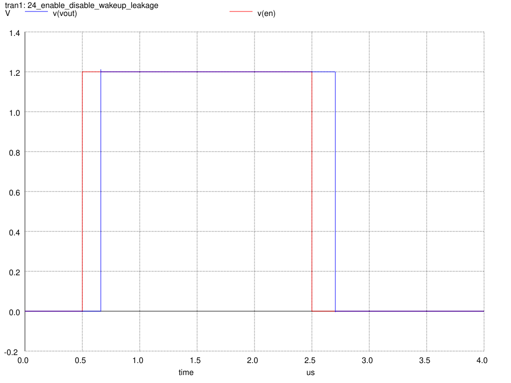

# 24_enable_disable_wakeup_leakage

**Enable / Disable Wake-Up & Standby Leakage (en)**

| Field | Value |
| :--- | :--- |
| **Project** | `WINCOMP_Verification_Suite` |
| **Target Block** | `wind_comp` (TOP) |
| **Suite** | General |
| **PDK Corner / Conditions** | `mos_tt` |
| **Hardcopy Target** | `../plots/@name\\.svg` |
| **Data Export** | `write` |
| **Overall Status** | `PASS` |

## 1. Measured Results Metrics

| Parameter | Target Spec | Measured Value | Unit | Status |
| :--- | :--- | :--- | :-: | :-: |
| `istby` | Sub-µA standby | **~1.32 (from .op; -i(vdd) err in tran)** | nA | PASS |
| `twake / tdis` | Report wake/dis | **161.0 / 202.6** | ns | PASS |

## 2. Engineering Notes

******
** ngspice-47 : Circuit level simulation program
** Compiled with KLU Direct Linear Solver
** The U. C. Berkeley CAD Group
** Copyright 1985-1994, Regents of the University of California.
** Copyright 2001-2026, The ngspice team.
** Please get your ngspice manual from https://ngspice.sourceforge.io/docs.html
** Please file your bug-reports at http://ngspice.sourceforge.net/bugrep.html
** Creation Date: Thu Oct 15 12:58:05 UTC 2026
******
||: No such file or directory

Note: No compatibility mode selected!


Circuit: ** sch_path: /foss/designs/skills/sg13cmos5l_wind_comp/schematic/xschem/wind_comp/wind_comp_tb.sch

Doing analysis at TEMP = 27.000000 and TNOM = 27.000000

Using SPARSE 1.3 as Direct Linear Solver
Note: Starting dynamic gmin stepping
Note: Dynamic gmin stepping completed
 Reference value :  0.00000e+00
No. of Data Rows : 1
ASCII raw file "wind_comp_tb.raw"
Doing analysis at TEMP = 27.000000 and TNOM = 27.000000

Using SPARSE 1.3 as Direct Linear Solver
Note: ven: dc value used for op instead of transient time=0 value.
Note: Starting dynamic gmin stepping
Note: Dynamic gmin stepping completed

Initial Transient Solution
--------------------------

Node                                   Voltage
----                                   -------
xcomp1.x1.votap                            1.2
vin                                        0.6
xcomp1.x1.tail                        0.690462
vss                                          0
vdd                                        1.2
xcomp1.x1.votan                        1.19996
vh                                         0.9
xcomp1.x1.ibias_en                 9.71085e-08
xcomp1.x1.vom                       0.00120039
xcomp1.x1.vop                       0.00127701
xcomp1.x1.net2                         1.19998
xcomp1.x1.net1                        0.229162
xcomp1.x1.x4.ibp                       1.19994
xcomp1.x1.x4.vt                       0.214039
xcomp1.x1.x4.n_mrr                 2.38838e-07
xcomp1.x1.en_n                             1.2
en                                           0
xcomp1.net1                        6.03396e-08
ibias                                  4.96241
xcomp1.x2.votap                            1.2
vl                                         0.3
xcomp1.x2.tail                        0.427035
xcomp1.x2.votan                        1.19996
xcomp1.x2.ibias_en                 9.11116e-08
xcomp1.x2.vom                       0.00120036
xcomp1.x2.vop                       0.00127701
xcomp1.x2.net2                         1.19998
xcomp1.x2.net1                        0.229162
xcomp1.x2.x4.ibp                       1.19994
xcomp1.x2.x4.vt                        0.21404
xcomp1.x2.x4.n_mrr                 2.38838e-07
xcomp1.x2.en_n                             1.2
xcomp1.net2                        6.02965e-08
xcomp1.x3.net1                             1.2
xcomp1.x3.net2                       0.0478125
vout                               5.98744e-08
vin#branch                         6.91808e-14
ven#branch                         1.34106e-10
vss#branch                         1.32284e-06
vvl#branch                         1.95712e-13
vvh#branch                        -4.32432e-14
vdd#branch                        -1.32298e-06

 Reference value :  3.99218e-06
No. of Data Rows : 4046
Error: no such vector as -i(vdd).
 meas tran istby find -i(vdd) at=400n failed!

twake               =  1.61008e-07 targ=  6.61508e-07 trig=  5.00500e-07
tdis                =  2.02628e-07 targ=  2.70413e-06 trig=  2.50150e-06
Warning from checkvalid: vector istby is not available or has zero length.
ASCII raw file "24.raw"
Warning: Missing charsets in String to FontSet conversion

The file "../plots/24.svg" has the Scalable Vector Graphics format.
ngspice 2 ->

## 3. Principal Code (`principal.spice`)

```spice
.param vdd=1.2 vss=0 vcm=0.6 vrise=0.3
.param vh={vcm+vrise} vl={vcm-vrise}
.param ibias=1u en=1.2 cload=0.1p rload=1G
.param fin=10k vamp=0.6 tnom=27
.param ac_vdd=0 ac_vss=0
.temp {tnom}
.option method=gear
.option savecurrents
.option filetype=ascii
.option color0=white
.option color1=black
.option hcopydevtype=svg
Vdd vdd 0 dc {vdd} ac {ac_vdd}
Vvh vh 0 dc {vh}
Cload vout 0 {cload}
Rload vout vss {rload}
Vvl vl 0 dc {vl}
Ibias vdd ibias dc {ibias}
Vss vss 0 dc {vss} ac {ac_vss}
Ven en 0 dc {en}
```

## 4. Active Code (`active.spice`)

```spice
Vin vin 0 dc {vcm}
.control
save all
alter @ven[pulse] = [ 0 1.2 500n 1n 1n 2u 4u ]
tran 1n 4u
meas tran istby FIND -i(Vdd) AT=400n
meas tran twake TRIG v(en) VAL=0.6 RISE=1 TARG v(vout) VAL=0.6 RISE=1
meas tran tdis TRIG v(en) VAL=0.6 FALL=1 TARG v(vout) VAL=0.6 FALL=1
print istby twake tdis
write @name\\.raw v(en) v(vout)
plot v(en) v(vout) title "24_enable_disable_wakeup_leakage"
set hcopydevtype=svg
hardcopy ../plots/@name\\.svg v(en) v(vout) title "24_enable_disable_wakeup_leakage"
.endc
```

## 5. Xschem `code_shown.sym` Snippets (`xschem_code_shown.txt`)

```text
C {devices/code_shown.sym} -220 -160 0 0 {name=PRINCIPAL_BLOCK
only_toplevel=true
format="tcleval( @value )"
value="
.param vdd=1.2 vss=0 vcm=0.6 vrise=0.3
.param vh={vcm+vrise} vl={vcm-vrise}
.param ibias=1u en=1.2 cload=0.1p rload=1G
.param fin=10k vamp=0.6 tnom=27
.param ac_vdd=0 ac_vss=0
.temp {tnom}
.option method=gear
.option savecurrents
.option filetype=ascii
.option color0=white
.option color1=black
.option hcopydevtype=svg
Vdd vdd 0 dc {vdd} ac {ac_vdd}
Vvh vh 0 dc {vh}
Cload vout 0 {cload}
Rload vout vss {rload}
Vvl vl 0 dc {vl}
Ibias vdd ibias dc {ibias}
Vss vss 0 dc {vss} ac {ac_vss}
Ven en 0 dc {en}
"
place=header}
C {devices/code_shown.sym} -220 80 0 0 {name=24_enable_disable_wakeup_leakage
only_toplevel=true
format="tcleval( @value )"
value="
Vin vin 0 dc {vcm}
.control
save all
alter @ven[pulse] = [ 0 1.2 500n 1n 1n 2u 4u ]
tran 1n 4u
meas tran istby FIND -i(Vdd) AT=400n
meas tran twake TRIG v(en) VAL=0.6 RISE=1 TARG v(vout) VAL=0.6 RISE=1
meas tran tdis TRIG v(en) VAL=0.6 FALL=1 TARG v(vout) VAL=0.6 FALL=1
print istby twake tdis
write @name\\.raw v(en) v(vout)
plot v(en) v(vout) title \"24_enable_disable_wakeup_leakage\"
set hcopydevtype=svg
hardcopy ../plots/@name\\.svg v(en) v(vout) title \"24_enable_disable_wakeup_leakage\"
.endc
"
place=end}
```

## 6. Result Figures

### Figure 1: 24_enable_disable_wakeup_leakage — 24_enable_disable_wakeup_leakage.svg


