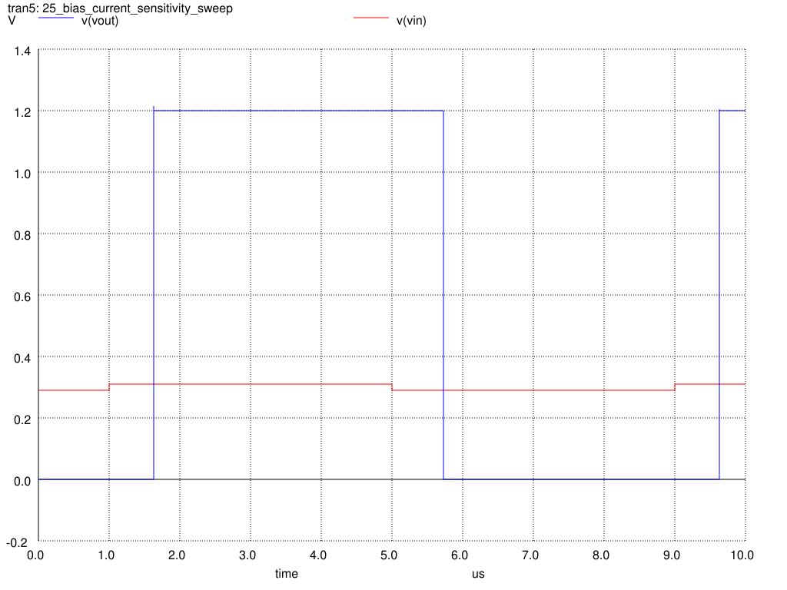

# 25_bias_current_sensitivity_sweep

**Bias Current Sensitivity Sweep (ibias)**

| Field | Value |
| :--- | :--- |
| **Project** | `WINCOMP_Verification_Suite` |
| **Target Block** | `wind_comp` (TOP) |
| **Suite** | General |
| **PDK Corner / Conditions** | `mos_tt` |
| **Hardcopy Target** | `../plots/@name\\.svg` |
| **Data Export** | `write` |
| **Overall Status** | `PASS` |

## 1. Measured Results Metrics

| Parameter | Target Spec | Measured Value | Unit | Status |
| :--- | :--- | :--- | :-: | :-: |
| `tplh / tphl @ 0.5u` | Report worst delay | **670.5 / 813.6** | ns | PASS |
| `pstat @ 5u` | Report max power | **31.86 (at vin=0.29V)** | µW | PASS |

## 2. Engineering Notes

******
** ngspice-47 : Circuit level simulation program
** Compiled with KLU Direct Linear Solver
** The U. C. Berkeley CAD Group
** Copyright 1985-1994, Regents of the University of California.
** Copyright 2001-2026, The ngspice team.
** Please get your ngspice manual from https://ngspice.sourceforge.io/docs.html
** Please file your bug-reports at http://ngspice.sourceforge.net/bugrep.html
** Creation Date: Thu Oct 15 12:58:05 UTC 2026
******
||: No such file or directory

Note: No compatibility mode selected!


Circuit: ** sch_path: /foss/designs/skills/sg13cmos5l_wind_comp/schematic/xschem/wind_comp/wind_comp_tb.sch

Doing analysis at TEMP = 27.000000 and TNOM = 27.000000

Using SPARSE 1.3 as Direct Linear Solver
Note: Starting dynamic gmin stepping
Note: Dynamic gmin stepping completed
 Reference value :  0.00000e+00
No. of Data Rows : 1
ASCII raw file "wind_comp_tb.raw"
Reset re-loads circuit ** sch_path: /foss/designs/skills/sg13cmos5l_wind_comp/schematic/xschem/wind_comp/wind_comp_tb.sch

Circuit: ** sch_path: /foss/designs/skills/sg13cmos5l_wind_comp/schematic/xschem/wind_comp/wind_comp_tb.sch

Doing analysis at TEMP = 27.000000 and TNOM = 27.000000

Using SPARSE 1.3 as Direct Linear Solver
Note: Starting dynamic gmin stepping
Note: Dynamic gmin stepping completed
 Reference value :  0.00000e+00
No. of Data Rows : 1
Doing analysis at TEMP = 27.000000 and TNOM = 27.000000

Using SPARSE 1.3 as Direct Linear Solver
Note: Starting dynamic gmin stepping
Note: Dynamic gmin stepping completed

Initial Transient Solution
--------------------------

Node                                   Voltage
----                                   -------
xcomp1.x1.votap                        1.06664
vin                                       0.29
xcomp1.x1.tail                        0.483788
vss                                          0
vdd                                        1.2
xcomp1.x1.votan                       0.729526
vh                                         0.9
xcomp1.x1.ibias_en                      0.1552
xcomp1.x1.vom                           0.4573
xcomp1.x1.vop                       5.0214e-05
xcomp1.x1.net2                     0.000868191
xcomp1.x1.net1                        0.848332
xcomp1.x1.x4.ibp                      0.715534
xcomp1.x1.x4.vt                       0.849875
xcomp1.x1.x4.n_mrr                    0.335858
xcomp1.x1.en_n                     6.03248e-08
en                                         1.2
xcomp1.net1                                1.2
ibias                                 0.155517
xcomp1.x2.votap                       0.809213
vl                                         0.3
xcomp1.x2.tail                       0.0353375
xcomp1.x2.votan                       0.818352
xcomp1.x2.ibias_en                      0.1552
xcomp1.x2.vom                         0.101148
xcomp1.x2.vop                         0.323685
xcomp1.x2.net2                             1.2
xcomp1.x2.net1                     0.000154834
xcomp1.x2.x4.ibp                      0.715534
xcomp1.x2.x4.vt                       0.568429
xcomp1.x2.x4.n_mrr                    0.408404
xcomp1.x2.en_n                     6.03268e-08
xcomp1.net2                        6.02931e-08
xcomp1.x3.net1                             1.2
xcomp1.x3.net2                         1.02641
vout                               5.98745e-08
vin#branch                        -3.83062e-13
ven#branch                        -2.32499e-10
vss#branch                          1.1492e-05
vvl#branch                        -6.02692e-13
vvh#branch                        -3.53886e-12
vdd#branch                        -1.14917e-05

 Reference value :  9.89260e-06
No. of Data Rows : 2055
tplh                =  6.70471e-07 targ=  1.67097e-06 trig=  1.00050e-06
tphl                =  8.13580e-07 targ=  5.81508e-06 trig=  5.00150e-06
Reset re-loads circuit ** sch_path: /foss/designs/skills/sg13cmos5l_wind_comp/schematic/xschem/wind_comp/wind_comp_tb.sch

Circuit: ** sch_path: /foss/designs/skills/sg13cmos5l_wind_comp/schematic/xschem/wind_comp/wind_comp_tb.sch

Doing analysis at TEMP = 27.000000 and TNOM = 27.000000

Using SPARSE 1.3 as Direct Linear Solver
Note: Starting dynamic gmin stepping
Note: Dynamic gmin stepping completed
 Reference value :  0.00000e+00
No. of Data Rows : 1
Doing analysis at TEMP = 27.000000 and TNOM = 27.000000

Using SPARSE 1.3 as Direct Linear Solver
Note: Starting dynamic gmin stepping
Note: Dynamic gmin stepping completed

Initial Transient Solution
--------------------------

Node                                   Voltage
----                                   -------
xcomp1.x1.votap                         1.0666
vin                                       0.29
xcomp1.x1.tail                        0.427272
vss                                          0
vdd                                        1.2
xcomp1.x1.votan                       0.673842
vh                                         0.9
xcomp1.x1.ibias_en                    0.179032
xcomp1.x1.vom                          0.55445
xcomp1.x1.vop                      4.96897e-05
xcomp1.x1.net2                     4.50246e-05
xcomp1.x1.net1                        0.952043
xcomp1.x1.x4.ibp                      0.653393
xcomp1.x1.x4.vt                       0.954275
xcomp1.x1.x4.n_mrr                    0.394196
xcomp1.x1.en_n                     6.03265e-08
en                                         1.2
xcomp1.net1                                1.2
ibias                                 0.179702
xcomp1.x2.votap                       0.793573
vl                                         0.3
xcomp1.x2.tail                       0.0203013
xcomp1.x2.votan                       0.802642
xcomp1.x2.ibias_en                    0.179032
xcomp1.x2.vom                         0.115453
xcomp1.x2.vop                          0.34875
xcomp1.x2.net2                             1.2
xcomp1.x2.net1                     0.000186358
xcomp1.x2.x4.ibp                      0.653393
xcomp1.x2.x4.vt                        0.60851
xcomp1.x2.x4.n_mrr                    0.488888
xcomp1.x2.en_n                       6.033e-08
xcomp1.net2                        6.02931e-08
xcomp1.x3.net1                             1.2
xcomp1.x3.net2                         1.02641
vout                               5.98745e-08
vin#branch                        -5.48957e-13
ven#branch                        -2.32164e-10
vss#branch                         8.77984e-06
vvl#branch                        -7.83915e-13
vvh#branch                        -6.04178e-12
vdd#branch                         -8.7796e-06

 Reference value :  9.90614e-06
No. of Data Rows : 2060
tplh                =  5.80467e-07 targ=  1.58097e-06 trig=  1.00050e-06
tphl                =  7.54639e-07 targ=  5.75614e-06 trig=  5.00150e-06
Reset re-loads circuit ** sch_path: /foss/designs/skills/sg13cmos5l_wind_comp/schematic/xschem/wind_comp/wind_comp_tb.sch

Circuit: ** sch_path: /foss/designs/skills/sg13cmos5l_wind_comp/schematic/xschem/wind_comp/wind_comp_tb.sch

Doing analysis at TEMP = 27.000000 and TNOM = 27.000000

Using SPARSE 1.3 as Direct Linear Solver
Note: Starting dynamic gmin stepping
Note: Dynamic gmin stepping completed
 Reference value :  0.00000e+00
No. of Data Rows : 1
Doing analysis at TEMP = 27.000000 and TNOM = 27.000000

Using SPARSE 1.3 as Direct Linear Solver
Note: Starting dynamic gmin stepping
Note: Dynamic gmin stepping completed

Initial Transient Solution
--------------------------

Node                                   Voltage
----                                   -------
xcomp1.x1.votap                        1.06592
vin                                       0.29
xcomp1.x1.tail                         0.35426
vss                                          0
vdd                                        1.2
xcomp1.x1.votan                       0.603285
vh                                         0.9
xcomp1.x1.ibias_en                    0.204985
xcomp1.x1.vom                         0.680754
xcomp1.x1.vop                      5.56141e-05
xcomp1.x1.net2                      1.6034e-06
xcomp1.x1.net1                         1.07154
xcomp1.x1.x4.ibp                      0.573933
xcomp1.x1.x4.vt                        1.07405
xcomp1.x1.x4.n_mrr                    0.431212
xcomp1.x1.en_n                      6.0328e-08
en                                         1.2
xcomp1.net1                                1.2
ibias                                 0.206415
xcomp1.x2.votap                       0.784474
vl                                         0.3
xcomp1.x2.tail                       0.0115175
xcomp1.x2.votan                       0.793511
xcomp1.x2.ibias_en                    0.204985
xcomp1.x2.vom                         0.124261
xcomp1.x2.vop                         0.363513
xcomp1.x2.net2                             1.2
xcomp1.x2.net1                     0.000535691
xcomp1.x2.x4.ibp                      0.573932
xcomp1.x2.x4.vt                       0.661464
xcomp1.x2.x4.n_mrr                    0.592286
xcomp1.x2.en_n                     6.03362e-08
xcomp1.net2                        6.02932e-08
xcomp1.x3.net1                             1.2
xcomp1.x3.net2                         1.02641
vout                               5.98745e-08
vin#branch                        -6.58432e-13
ven#branch                        -2.31854e-10
vss#branch                         1.42317e-05
vvl#branch                        -9.02119e-13
vvh#branch                        -1.10748e-11
vdd#branch                        -1.42315e-05

 Reference value :  9.95237e-06
No. of Data Rows : 2058
tplh                =  5.59003e-07 targ=  1.55950e-06 trig=  1.00050e-06
tphl                =  7.28671e-07 targ=  5.73017e-06 trig=  5.00150e-06
Reset re-loads circuit ** sch_path: /foss/designs/skills/sg13cmos5l_wind_comp/schematic/xschem/wind_comp/wind_comp_tb.sch

Circuit: ** sch_path: /foss/designs/skills/sg13cmos5l_wind_comp/schematic/xschem/wind_comp/wind_comp_tb.sch

Doing analysis at TEMP = 27.000000 and TNOM = 27.000000

Using SPARSE 1.3 as Direct Linear Solver
Note: Starting dynamic gmin stepping
Note: Dynamic gmin stepping completed
 Reference value :  0.00000e+00
No. of Data Rows : 1
Doing analysis at TEMP = 27.000000 and TNOM = 27.000000

Using SPARSE 1.3 as Direct Linear Solver
Note: Starting dynamic gmin stepping
Note: Dynamic gmin stepping completed

Initial Transient Solution
--------------------------

Node                                   Voltage
----                                   -------
xcomp1.x1.votap                        1.01174
vin                                       0.29
xcomp1.x1.tail                        0.212371
vss                                          0
vdd                                        1.2
xcomp1.x1.votan                       0.477852
vh                                         0.9
xcomp1.x1.ibias_en                    0.245094
xcomp1.x1.vom                         0.900365
xcomp1.x1.vop                      0.000108279
xcomp1.x1.net2                      8.8634e-08
xcomp1.x1.net1                         1.19189
xcomp1.x1.x4.ibp                      0.430221
xcomp1.x1.x4.vt                        1.19217
xcomp1.x1.x4.n_mrr                    0.255367
xcomp1.x1.en_n                     6.03243e-08
en                                         1.2
xcomp1.net1                                1.2
ibias                                   0.2491
xcomp1.x2.votap                       0.778457
vl                                         0.3
xcomp1.x2.tail                      0.00569927
xcomp1.x2.votan                       0.787478
xcomp1.x2.ibias_en                    0.245094
xcomp1.x2.vom                         0.130283
xcomp1.x2.vop                         0.373329
xcomp1.x2.net2                             1.2
xcomp1.x2.net1                       0.0270152
xcomp1.x2.x4.ibp                      0.430218
xcomp1.x2.x4.vt                       0.791417
xcomp1.x2.x4.n_mrr                    0.750624
xcomp1.x2.en_n                     6.03526e-08
xcomp1.net2                        6.02932e-08
xcomp1.x3.net1                             1.2
xcomp1.x3.net2                         1.02641
vout                               5.98745e-08
vin#branch                        -7.62945e-13
ven#branch                        -2.31474e-10
vss#branch                         2.65498e-05
vvl#branch                        -9.85545e-13
vvh#branch                        -3.15421e-11
vdd#branch                        -2.65495e-05

 Reference value :  9.95660e-06
No. of Data Rows : 2054
tplh                =  6.28973e-07 targ=  1.62947e-06 trig=  1.00050e-06
tphl                =  7.26860e-07 targ=  5.72836e-06 trig=  5.00150e-06
ASCII raw file "25.raw"
Warning: Missing charsets in String to FontSet conversion

The file "../plots/25.svg" has the Scalable Vector Graphics format.
ngspice 2 ->

## 3. Principal Code (`principal.spice`)

```spice
.param vdd=1.2 vss=0 vcm=0.6 vrise=0.3
.param vh={vcm+vrise} vl={vcm-vrise}
.param ibias=1u en=1.2 cload=0.1p rload=1G
.param fin=10k vamp=0.6 tnom=27
.param ac_vdd=0 ac_vss=0
.temp {tnom}
.option method=gear
.option savecurrents
.option filetype=ascii
.option color0=white
.option color1=black
.option hcopydevtype=svg
Vdd vdd 0 dc {vdd} ac {ac_vdd}
Vvh vh 0 dc {vh}
Cload vout 0 {cload}
Rload vout vss {rload}
Vvl vl 0 dc {vl}
Ibias vdd ibias dc {ibias}
Vss vss 0 dc {vss} ac {ac_vss}
Ven en 0 dc {en}
```

## 4. Active Code (`active.spice`)

```spice
Vin vin 0 pulse(0.29 0.31 1u 1n 1n 4u 8u)
.control
save all
foreach ib 0.5u 1u 2u 5u
  alterparam ibias=$ib
  reset
  save all
  op
  let pstat = -i(Vdd) * v(vdd)
  set pstat_val = $&pstat
  tran 5n 10u
  meas tran tplh TRIG v(vin) VAL=0.3 RISE=1 TARG v(vout) VAL=0.6 RISE=1
  meas tran tphl TRIG v(vin) VAL=0.3 FALL=1 TARG v(vout) VAL=0.6 FALL=1
  echo $ib $pstat_val $&tplh $&tphl >> @name\\.txt
end
write @name\\.raw v(vin) v(vout)
plot v(vin) v(vout) title "25_bias_current_sensitivity_sweep"
set hcopydevtype=svg
hardcopy ../plots/@name\\.svg v(vin) v(vout) title "25_bias_current_sensitivity_sweep"
.endc
```

## 5. Xschem `code_shown.sym` Snippets (`xschem_code_shown.txt`)

```text
C {devices/code_shown.sym} -220 -160 0 0 {name=PRINCIPAL_BLOCK
only_toplevel=true
format="tcleval( @value )"
value="
.param vdd=1.2 vss=0 vcm=0.6 vrise=0.3
.param vh={vcm+vrise} vl={vcm-vrise}
.param ibias=1u en=1.2 cload=0.1p rload=1G
.param fin=10k vamp=0.6 tnom=27
.param ac_vdd=0 ac_vss=0
.temp {tnom}
.option method=gear
.option savecurrents
.option filetype=ascii
.option color0=white
.option color1=black
.option hcopydevtype=svg
Vdd vdd 0 dc {vdd} ac {ac_vdd}
Vvh vh 0 dc {vh}
Cload vout 0 {cload}
Rload vout vss {rload}
Vvl vl 0 dc {vl}
Ibias vdd ibias dc {ibias}
Vss vss 0 dc {vss} ac {ac_vss}
Ven en 0 dc {en}
"
place=header}
C {devices/code_shown.sym} -220 80 0 0 {name=25_bias_current_sensitivity_sweep
only_toplevel=true
format="tcleval( @value )"
value="
Vin vin 0 pulse(0.29 0.31 1u 1n 1n 4u 8u)
.control
save all
foreach ib 0.5u 1u 2u 5u
  alterparam ibias=$ib
  reset
  save all
  op
  let pstat = -i(Vdd) * v(vdd)
  set pstat_val = $&pstat
  tran 5n 10u
  meas tran tplh TRIG v(vin) VAL=0.3 RISE=1 TARG v(vout) VAL=0.6 RISE=1
  meas tran tphl TRIG v(vin) VAL=0.3 FALL=1 TARG v(vout) VAL=0.6 FALL=1
  echo $ib $pstat_val $&tplh $&tphl >> @name\\.txt
end
write @name\\.raw v(vin) v(vout)
plot v(vin) v(vout) title \"25_bias_current_sensitivity_sweep\"
set hcopydevtype=svg
hardcopy ../plots/@name\\.svg v(vin) v(vout) title \"25_bias_current_sensitivity_sweep\"
.endc
"
place=end}
```

## 6. Result Figures

### Figure 1: 25_bias_current_sensitivity_sweep — 25_bias_current_sensitivity_sweep.svg


